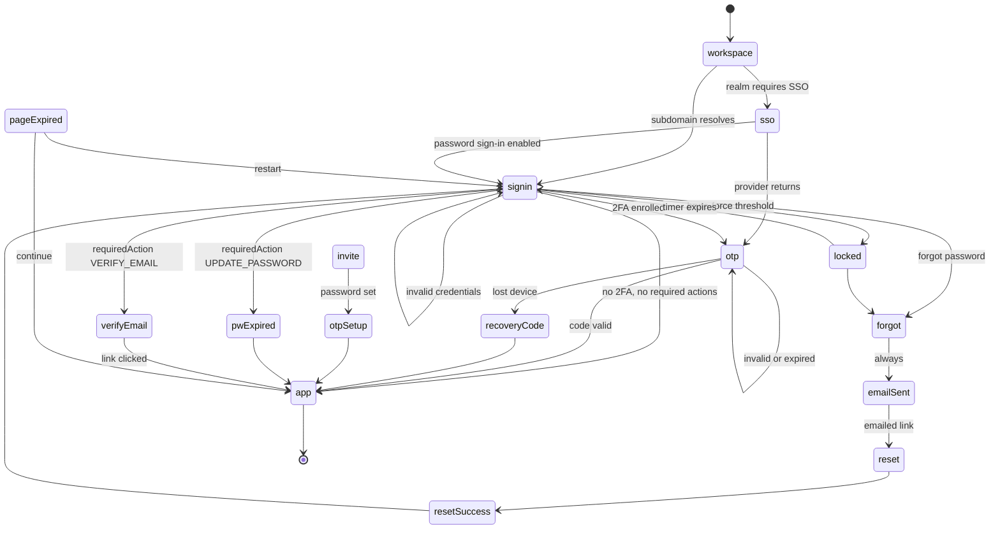
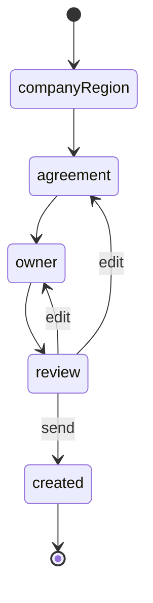
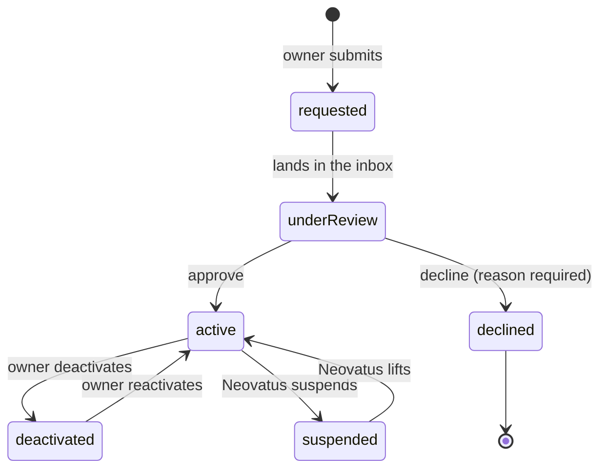
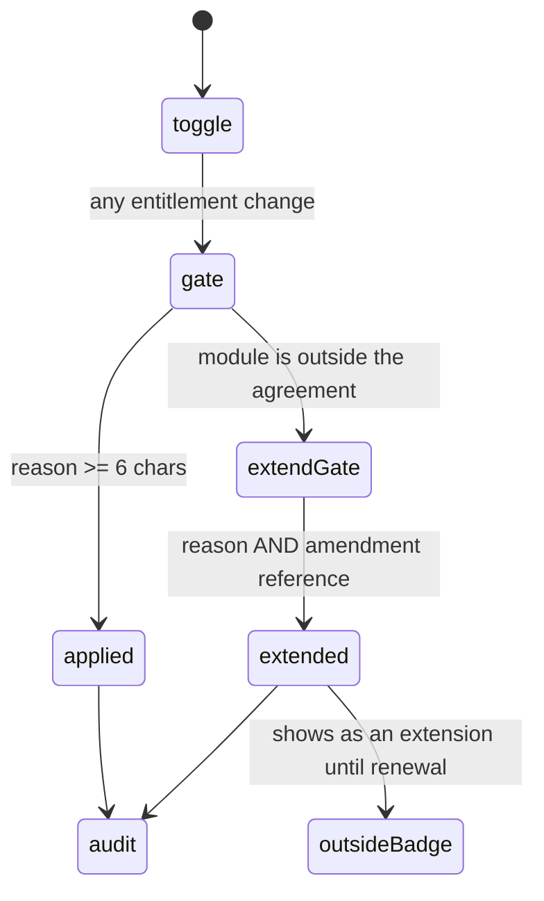
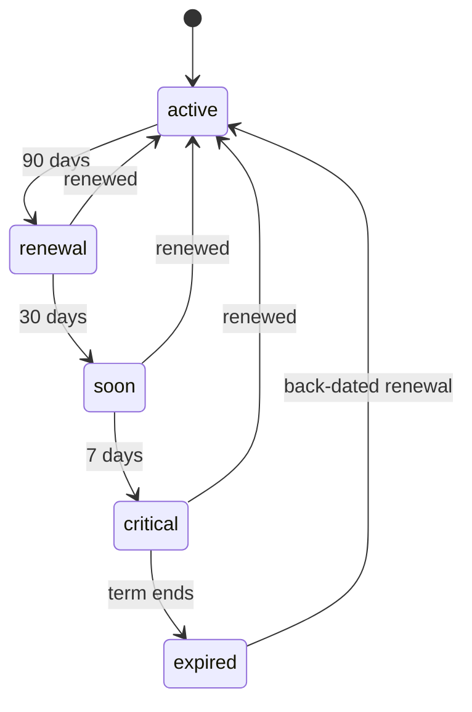
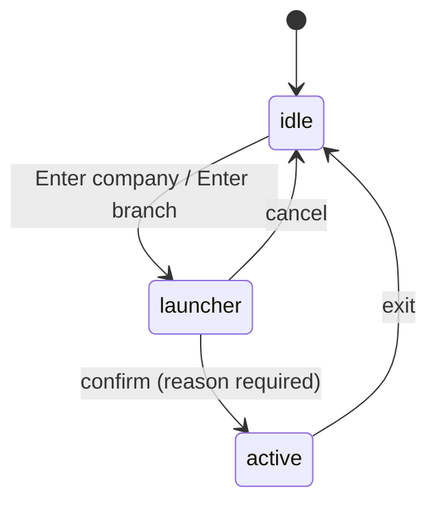
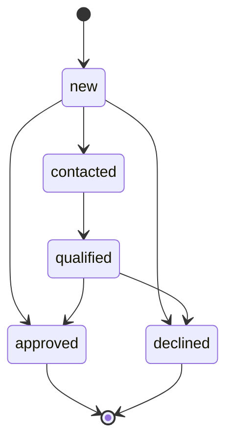

# Flows & states

Every flow in the designed surfaces, as state machines. The machine-readable
version is `flows.json` — same content, same ids, structured for an agent to
build routing and guards from directly. This file is the one to read.

Diagrams are Mermaid. GitHub, GitLab, VS Code and most agents render them; if
yours doesn't, the arrows read fine as text.

---

## 1. Authentication

Eleven of thirteen screens are **Keycloak login-theme templates**, not
application routes. Keycloak owns the URL, the form action, the CSRF token and
the error state. The template name is on each node.



**Invite is the entire staff onboarding path.** It is
`login-update-password.ftl` reached from a Keycloak Execute-Actions email. There
is no signup page anywhere in the ERP (R1), and registration must be disabled at
realm level.

**Three screens share one template.** Invite, Reset and Password Expired are all
`login-update-password.ftl` with different framing. That is what makes
invite-only onboarding cheap.

### Guards that are security rules, not UX choices

| Guard | Rule |
|---|---|
| Sign-in failure message | One generic message for unknown account *and* wrong password. Splitting them leaks which staff addresses exist in a tenant. |
| Forgot password | Always reports success, whether or not the address exists. |
| Cross-surface | A customer address in staff sign-in — and the reverse — must respond identically to any other address. |

### Realm configuration the design assumes

Prerequisites, not suggestions. The design is wrong on screen without them.

`realm per tenant` · `registration DISABLED` · `brute-force detection on` ·
`rememberMe on` · `reset password on` · `OTP totp 6 digits / 30s` ·
`12 single-use recovery codes` · `verify email required` ·
`all copy in messages_en.properties`

---

## 2. Company enrollment

Super Admin only. This is the only way a company comes into existence.



**Step 2 is the important one.** It defines the *ceiling*:

- **Modules in this agreement** — branches can switch these off, never on.
- **Limits** — users, branches, warehouses. Hard ceilings (R10). Unlimited is an
  explicit checkbox; `0` means unlimited in the data and is never shown as `0`.
- **No plan tiers** (R2). An earlier version had Single-site / Multi-branch /
  Group presets — a tier ladder wearing a different hat. Removed.

**Step 3 sends a Keycloak invitation.** It never sets a password. The step is
labelled "Owner invitation", or just "Owner" when the owner already exists and
no invitation is sent.

---

## 3. Branch lifecycle

The owner **requests**; Super Admin **creates**. The owner can activate and
deactivate freely afterwards.



Creation is a commercial event — it consumes an agreement limit and may change
what is billed. Day-to-day operation is not; making an owner file a ticket to
close a shop for renovation is the friction that stops people using the system.

### Deactivate ≠ suspend

| | Deactivate | Suspend |
|---|---|---|
| Who | Company owner | Neovatus |
| Why | Operational — renovation, seasonal close | Commercial — non-payment, compliance hold |
| Reversible by | The owner | Only Neovatus |

One button for both is how a paying customer's shop gets switched off by
accident, or a non-paying one switched back on by their own admin.

### The approval decides four things

Three of them are financial and **none is inferred from another**:

```
ownership : company | franchise
books     : own | group      ← a managed franchise can be consolidated
billing   : own | group      ← independent of books
modules   : inherit | explicit set
```

A managed franchise can have its own owner and group books. A franchisee with
own books can still be billed through the group. Both are real arrangements.

**Consolidation rule the Finance module must honour:** the group sees a
franchise's numbers consolidated; the franchise sees only its own, never the
group's.

---

## 4. Entitlement resolution

Not a flow — a resolution order. It runs on every access check.

```
1. Agreement ceiling   is this module in the agreement at all?
2. Company default     of what is entitled, what is on by default?
3. Branch override     inherit | on | off
4. Feature override    inherit | on | off, per feature
```

`inherit` is the default at every level and should be what the data holds ~95%
of the time. Store overrides sparsely — `{branchId: 'on'|'off'}` — and never
materialise a full matrix.

A franchise holding its own agreement is entitled **by that contract**, not the
group's. Resolve through `agreementForBranch()`; never `.find()` your way to a
contract.

### The ceiling is soft, but it remembers

Super Admin *can* enable a module outside the agreement. It is not blocked —
Neovatus holds the agreement, so a wall is theatre; the operator would amend and
come straight back, having recorded nothing.



An extension turns the notice red, **requires** an amendment reference, renames
the button to *Extend agreement & apply*, badges the module **Outside
agreement**, and shows in the summary as a separate red `+N`. The freedom is the
same; the debt is visible.

**Every change passes the reason gate, and every gate writes to the audit log.**
Six months later the only question that matters is who agreed to this, and a
toggle cannot answer it.

---

## 5. Agreement lifecycle



| Renewal mode | Behaviour |
|---|---|
| `auto` | Rolls unless cancelled |
| `manual` | **Lapses untouched** — the failure mode worth surfacing |

Agreements attach at **two levels**. A franchise may hold its own, in which case
two contracts expire on different days. Branch detail shows the franchise's own
countdown *and* names the group's separate expiry. Never show one and imply the
other.

Where expiry surfaces: dashboard panel (all agreements, soonest first, company
and franchise together) · tenant banner inside 30 days · status chip everywhere
else.

---

## 6. Impersonation



- **Reason required** before entering.
- **Banner always visible** while active — fixed, non-dismissable, naming who
  you are acting as and why, with a live timer and an always-present Exit.
- **Every action double-logged** — once as the acting user, once as you.
- Entry points on the company and branch pages, **visible only to Super Admin**,
  never in the tenant's own chrome.

The banner exists so you can never forget you are inside someone else's company.
The double log exists so the tenant can always tell what was them and what was
us.

---

## 7. Requests

One inbox for everything a tenant asks for: branch creation, limit increases,
module additions, user resets. Four inboxes means three go unread.



**Open** means *neither Approved nor Declined* — a Contacted or Qualified
request is still work in progress. One predicate, `isOpenRequest()`, feeds the
dashboard KPI, the sidebar badge, the page banner and the inbox header.

---

## Shared predicates

Each of these existed in two places at some point in this design, and each time
the two copies disagreed on screen. They are now single definitions with named
consumers — treat that as a constraint to preserve, not an implementation detail.

| Predicate | Definition | Consumers |
|---|---|---|
| `isOpenRequest` | `status !== 'Approved' && !== 'Declined'` | dashboard KPI, sidebar badge, requests banner, inbox header |
| `branchNeedsOwner` | `ownership === 'franchise' && !owner` | branches KPI, branches owner cell, branch detail owner row |
| `agreementState` | reads `state`/`daysRemaining`/`percentElapsed` off the record — the org-service's own fields, never recomputed | chip, card, banner, dashboard panel, agreements screen |
| `agreementForBranch` | branch's own agreement, else the group's | branch detail, branches list, all agreements |
| `branchRecord` | a branch across both datasets, or `null` | branch detail |

---

## Why this rather than screenshots or Figma

Screenshots capture one width and one moment. They cannot express a guard, a
transition, or why a button is disabled — which is most of what this design is.
They were removed from the bundle for that reason.

Figma has the same problem for flow, and PNGs imported into Figma are flat
images: not layers, not components, not editable. If you want Figma, the only
high-value step is importing `neoerp-tokens.json` through the Tokens Studio
plugin — it is already in that format and produces real variables and styles.
Rebuilding components by hand is about a day's work and only worth it if design
continues in Figma.

If the team builds straight to code, `flows.json` + `styles.css` + the token
file is a stronger contract than any Figma file, because it cannot drift from
what ships.

**To see a state, run the screen rig** in the frontend repo: `NeoERP-App/docs/design/screen-rig/app.html` (the old `_prototype` was removed 2026-10-15).
then use the Tweaks panel to jump to any screen, toggle theme, density and
environment. That is more accurate than any static capture.
