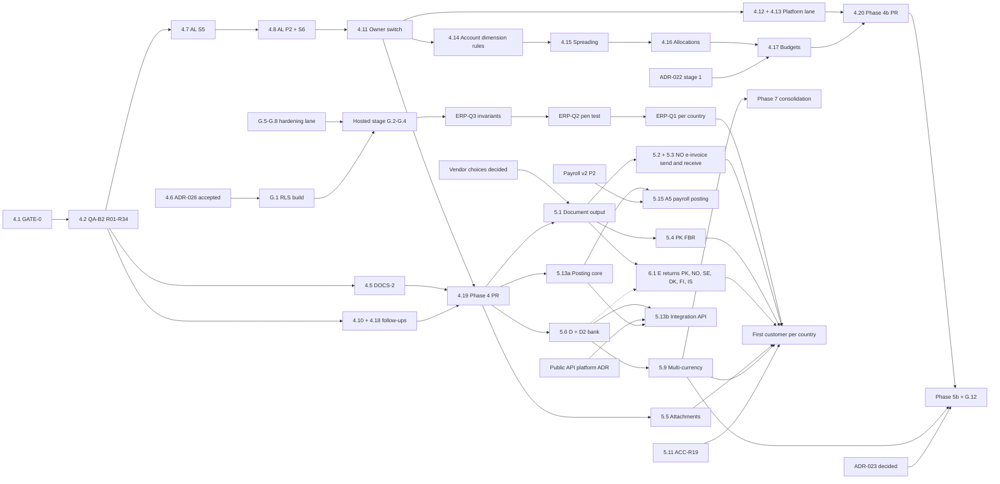

# Accounts roadmap

Status: **Approved Accounts roadmap. Decisions 1–16 (§7) decided by Jabran 2026-11-21** (decision 16 answered earlier the
same day). The body (§1–§6) follows those decisions. This roadmap feeds ROADMAP-P (the one product roadmap, state:29).
Written 2026-11-21 (batch 2, Opus). Brief: `docs/agents/accounts-roadmap/brief.md`. Read only: both code repos at
`origin/phase/4` (BackEnd `e36b6c6a`, App `bff8d14c`) and `origin/main` (BackEnd `c6d5a6ff`, App `370ad7a6`).

Short names: **BE** = `NeoERP-BackEnd`, **App** = `NeoERP-App`, **WS** = this workspace.
`roadmap:N` = `BE/docs/api/accounts-roadmap.md` line N. `backlog:N` = `WS/docs/backlog.md` line N.
`state:N` = `WS/PROJECT-STATE.md` line N. `gates` = `BE/docs/operations/hosting-and-go-live-requirements.md`.
Size: S (days), M (1–2 weeks), L (more). Risk: **money**, **security**, **statutory**, or none.

## 1. Product direction

- Built for large multi-company customers from day one, sold by module (`WS/docs/large-customer-roadmap.md:7`).
- Every large-customer feature is optional per company and off by default (same file, line 11).
- The large-customer quality bar is not lowered for any business: Phase 5b and G.12 stay in the normal build order,
  and the money, security, pen-test and accountant gates apply to every customer (decision 2).
- Multi-company groups are welcome from day one, each company with its own books and the multi-company close board
  (5b.2); no customer that depends on consolidation or inter-company automation before Phase 7 (decision 15).
- Dimensions, budgets and reporting are core: ADR-021 accepted; ADR-022 and ADR-023 still Proposed in their files
  (`BE/docs/adr/ADR-022-budget-control.md:5`, `ADR-023-reporting-layer.md:5`). ADR-022 stage 1 is accepted before
  budgets (4.17); ADR-023 at the start of Phase 5b (decision 3).
- No pilot customer and no single first country. The first market group is **Pakistan and the Nordic countries
  (SE, NO, DK, FI, IS) together**, then other EU countries, then other countries (§7 correction note). The old launch
  order SE → NO → PK → FI → IS → DK (roadmap:92) is withdrawn. Where a country order is needed, this roadmap uses
  **PK → NO → SE → DK → FI → IS** (as Payroll D1; decisions 9 and 13).
- NeoERP will offer public APIs to third parties; the first one (5.13b) waits for a public API platform ADR (decision 6).

## 2. Naming: old phase numbers against today's

The approved build table (roadmap:84-92, 2026-10-10) uses phase numbers that no longer match the work. It gets a
short "superseded" amendment that points here (decision 4).

| Today | What it holds | Old table |
|---|---|---|
| Phase 3 (done, on `main`) | B, C, M5, SB2d dimensions, OI, OBI CSV/Excel | Phases 1–3 |
| Phase 4 (now) | A4, QA batch 2 (R01–R34), approval limits through S6 and app P2, DOCS-2, owner switch; own PR to `main` (decision 1) | old 4 = A5 + A4 |
| Phase 4b | Platform lane, account dimension rules, spreading, allocations, budgets; own PR (decision 1) | new |
| Phase 5 | Documents and e-invoicing first, then bank, FX and payment files (roadmap:69); posting core and A5 (decisions 5, 6, 7) | old 5 (A5 from old 4) |
| Phase 5b | Controls and close (roadmap:70), fixed assets | new |
| Phase 6 | Tax returns and statutory files per country, starting right after document output (decision 9) | old 6 |
| Phase 7 | Intercompany and consolidation (roadmap:71), firm slot in the build order (decision 15) | new |

## 3. Inventory: every Accounts spec and API doc

19 app specs (`App/docs/design/specs/accounts-*.md`), 28 API docs (`BE/docs/api/accounts-*.md`) and the old
`BE/docs/api/accounts.md`.
Many headers still say "not built" although the code is built. State below comes from migrations and code, not headers.
Migrations: `BE/services/accounts-service/src/main/resources/db/migration/`.

| # | Slice | App spec | API doc | State | Evidence |
|---|---|---|---|---|---|
| 1 | A0 setup and go-live | a0 | a0 | Done (main) | V6–V9 |
| 2 | A1 journals | a1 | a1 | Done (main) | V10; API header "built (CP-A1.1, 1f85eb6)" |
| 3 | A2 TB, ledger, periods | a2-a3 | a2 | Done (main) | V11; App `presentation/periods`, `reports/tb`, `gl` |
| 4 | A3 statements, year-end | a2-a3 | a3 | Done (main); header still says draft | V13, V20; App `presentation/yearend`, `reports/statements` |
| 5 | A3b cash flow | a2-a3 | (in a3) | Done (main) | V14; `service/report/cashflow/CashFlowReadService.kt` |
| 6 | H-SE SIE 4 | h-se | h-se | Done (main); header still says draft | V16, V17, V19; `service/sie`, App `reports/sie` |
| 7 | OBI opening-balance import | ob-import | ob-import | CSV/Excel done (main); SAF-T reader (CP-OBI.3) not started | V64; API header line 3 |
| 8 | OI opening items at go-live | opening-items-import | opening-items-import | Done (main); API header says app not built, but it is | V34, V38; App `presentation/openingimport` |
| 9 | B receivables (+ M5) | b-c | b | Done (main) | V26–V30, V52–V55, V59 |
| 10 | C payables (+ M5) | b-c | c | Done (main) | V31–V33, V45, V49–V51, V56–V58 |
| 11 | Payment reference agreements | — | reference-agreements | Done (main) | V50 |
| 12 | Packs 2026.2 / .3 / .4 / .5 / .5-pk / .5-tax | — | packs-2026-2, -3, -4, -5, -5-pk, -5-tax | Done (main) | V12, V15, V42, V46, V47, V48 (Kotlin migrations) |
| 13 | Dimensions on lines | dimensions | (ADR-021) | Part done: storage, maintenance, pickers (main). Not started: account rules D6, department, branch default cost centre | V60–V65; backlog:320 |
| 14 | A4 journal productivity | a4 | a4 | Done (main). Leftovers not started (UI); QA-B2 fixes open | V67–V69; backlog:390; state:20 |
| 15 | AL approval limits | approval-limits | approval-limits | In progress: S1–S4 + app P1 done (S3 on main, S4 on phase/4). S5, app P2 and S6 acceptance open (roadmap:121) | V70 (main), V71 (phase/4); App `presentation/approvallimits`; state:25 |
| 16 | Allocations | allocations | — | Not started (draft spec) | no allocation-key code; spec status line |
| 17 | Spreading schedules | (none) | (none; out of A4, `api/accounts-a4.md:88`) | Not started, no spec | `domain/recurring/Schedule.kt:8` leaves room |
| 18 | Budgets stage 1 | budgets | — (ADR-022 Proposed) | Not started | no budget code in accounts-service |
| 19 | Integrations + import with dimensions | integrations | — (ADR-021 Q13/Q14 open in the ADR; answered in decision 6) | Not started | ADR-021 status line |
| 20 | Multi-currency | multi-currency | — | Not started | spec status line |
| 21 | Fixed assets | fixed-assets | — | Not started | no fixed-asset code in accounts-service ("depreciation" appears only in chart and layout data) |
| 22 | Bank feeds + payment files (D3/PF-1) | bank-feeds | — | Not started | spec status line |
| 23 | D + D2 bank and cash | d-e | d | Not started (draft) | API header line 6 |
| 24 | E tax report and returns | d-e | e | Not started (draft) | API header line 3 |
| 25 | Document output + e-invoicing | docout | docout | Not started (approved G-5). FBR states and Noop provider done (F1) | V59; `App/.../accounts-docout.md` §0 |
| 26 | Attachments | attachments | attachments | Not started (draft) | API header line 3 |
| 27 | A5 payroll posting (AccountsPostingV2) | — | a5 | Not started (approved G-7). Machine posting v1 exists | `delivery/http/internal/postings/MachinePostingController.kt`; API header line 3 |
| 28 | H-NO, H-DK, H-PK, H-FI, H-IS | — | h-design | Not started (design draft) | API header line 3 |
| 29 | F franchise charges | — | f-design | Not started (design draft) | API header |
| 30 | G group view | — | g-design | Not started (design draft) | API header |
| 31 | Reference docs | — | decisions-for-jabran, roadmap, accounts (superseded by a0) | Reference only | `api/accounts.md:3` |

Not placed in a phase: row 31 (reference docs). Every other row is in §4.

## 4. Phases

### Phase 4, rest (now)

Phase 4 = QA batch 2 (R01–R34), approval limits through S6 and app P2, DOCS-2 and the owner switch. It merges to
`main` with its own PR (4.19). The other items of the 2026-11-16 order (backlog:389) move to Phase 4b (decision 1).

| # | Item | Why here | Depends on | Size | Risk |
|---|---|---|---|---|---|
| 4.1 | GATE-0 machine gates (verify.sh, pre-push, money invariant check, tenant arch test on 8 services, risk paths) | Approved first step of batch 2 (state:21). Running in `NeoERP-worktrees/lane0-be` | — | M | money, security |
| 4.2 | QA-B2 fix lanes R01–R34, layout and wording (`docs/agents/qa-round1-retest/fix-list.md`) | Approved 2026-11-20 (state:20); range R01–R34 per decision 1 | 4.1 | M | money (R12), data |
| 4.3 | R29: classify 60 outbound repositories and ports for company scope (fix-list R29, `5d33c65`) | Lane 0 finding, inside the R01–R34 range; ratchet before Phase 4 PR | 4.1 | S | security |
| 4.4 | DOCS-1 docs clean-up | Done: merged in `16112eb`; state row closed in `e2a71d5` (master) | — | S | none |
| 4.5 | DOCS-2 user and developer pages for A4 features, refunds, write-offs | Jabran 2026-11-21 (state:23). Worktrees `docs2-app`, `docs2-be` hold briefs only | 4.2 | M | none |
| 4.6 | ISO-1: ADR-026 row-level security | Answers ERP-Q4. Draft on branch `phase/4-b2-iso1` (e2f87a5); ADR-026 accepted 2026-11-21 (decision 3) | — | S (doc) | security |
| 4.7 | AL S5 payments and refunds (accounts V75) | After QA-B2 (Jabran 2026-11-21, state:44) | 4.2 | M | money |
| 4.8 | AL app P2 steps card, then S6 acceptance (roadmap:121) | Follows S5 (state:25) | 4.7 | M | money |
| 4.9 | AL small reads: decide-roles read, `confirmedByUserId` (backlog:392-399) | Finish AL in one go | 4.7 | S | security |
| 4.10 | A4 leftovers: Automatic reversals tab, "{n} recurring journals need you" notice (backlog:390) | After A4 click-through. Not started (UI); access rules and data layer present (`presentation/RecurringAccess.kt`, `data/remote/ScheduledReversalsApi.kt`) | 4.2 | S | none |
| 4.11 | Switch "Owner may not post own journal" + self-approval report (AL-D18) | First in the approved order (backlog:389); last Phase 4 item (decision 1). Not built: V71 only records `owner_self_approval` | 4.8 | S | money |
| 4.18 | Report and QA1 follow-ups: journal listing exact dates, phone period line, TB hint, P12/P13 note, older layouts, QA1 leftovers G15/G19/G25/G30/G44 (backlog:395-412); NO domestic bill defaults to an import VAT code, needs company default tax codes (backlog:327) | Small, same screens as QA-B2 | 4.2 | S–M | money (tax default) |
| 4.19 | Phase 4 PR to `main` (one PR per repo) | Branch-per-phase rule; Phase 4 has its own PR (decision 1) | 4.1–4.11, 4.18 | S | — |

### Phase 4b: platform and planning

Own PR to `main` (4.20). Order: platform lane, account dimension rules, spreading, allocations, budgets
(decision 1; backlog:389).

| # | Item | Why here | Depends on | Size | Risk |
|---|---|---|---|---|---|
| 4.12 | Platform lane: ADR-025 RT-0..RT-2, ADR-024 Stage 0 (backlog:347) | Phase 4b, in parallel with the account-dimension chain (approved order, backlog:389; decisions 1 and 3) | ADR-024 and ADR-025 accepted, with ADR-025 additions A1 event snapshots, A2 `Prefer` header, A3 the rule after the foundation (decision 3; backlog:385; state:26) | L | security (notifications carry data) |
| 4.13 | RT-3..RT-5: SSE hub, app realtime, first Accounts screens (backlog:348) | Follows RT-0..RT-2 in the platform lane | 4.12 | M | none |
| 4.14 | Company dimensions per account: D6 Required/Optional/Not used, range rules, branch default cost centre (backlog:320) | Allocations and budgets read these rules | SB2d (done) | M | money (posting refusals) |
| 4.15 | Spreading schedules (prepaid costs, deferred income) | Approved order (roadmap:68). No spec yet | 4.14; reuse `domain/recurring` | M | money |
| 4.16 | Allocations v1 (AC-ALC): fixed %, key tables (e.g. floor area) and "from the ledger" shares (decision 14) | Approved order | 4.14, 4.15 (shared run table). Headcount key comes later with L.9, after HR v2 H1 (decision 14) | M | money |
| 4.17 | Budgets stage 1 (AC-BUD): versions, grid, budget vs actual vs forecast, variance flags | Approved order; core for large customers | ADR-022 stage 1 accepted before 4.17 (decision 3); 4.14 | L | none (never posts) |
| 4.20 | Phase 4b PR to `main` (one PR per repo) | Own PR (decision 1) | 4.12–4.17 | S | — |

### Phase 5: documents and bank

Phase 5 starts right after Phase 4 merges (4.19). Before it starts, Jabran decides the three vendor choices: the Peppol
access point (D-121/D-123) and the PK FBR route (D-125). The comparisons are prepared in `docs/agents/vendor-choices/`
(branch `phase/4-b2-vendors`); the Pakistan FBR/PRAL sandbox paperwork starts early (decision 10).

Order: document output (5.1) and NO e-invoice send and receive (5.2, 5.3) come first (decision 7). The tax returns
(6.1) start right after 5.1 (decision 9). The AccountsPostingV2 core (5.13a) is built early in Phase 5, with A5 (5.15)
as first user, timed by Payroll v2 P2 (decisions 5, 6). The outside-systems API (5.13b) comes after D (5.6), preceded
by a public API platform ADR (decision 6). The other rows follow in table order unless a dependency says otherwise.

| # | Item | Why here | Depends on | Size | Risk |
|---|---|---|---|---|---|
| 5.1 | Document output: invoice and credit-note PDF per country (AC-DO). Folds M5 items: signed subtotals (backlog:243), customer-language line text (backlog:283), advance receipt text (backlog:251) | Old phase 5 (roadmap:90); first in Phase 5 and the base for NO EHF, PK FBR and SE/DK/FI Peppol (decision 7) | Phase 4 PR (4.19) | L | statutory |
| 5.2 | E-invoice send: NO EHF (required, gates L-1), DK, FI, IS; SE Peppol BIS / Svefaktura (the SE gate, roadmap:154, asks only for document output) | First in Phase 5 with 5.1 (decision 7); NO law in force 2027-01-01 (gates L-1). Not a promise of delivery by that date: Phase 4 finishes first | 5.1; Peppol access point D-121/D-123 chosen before 5.2 (decisions 7, 10); P-9 mail; H-7 DPA | L | statutory |
| 5.3 | NO e-invoice receive (Peppol) | First in Phase 5 with 5.2 (decision 7). NO gate needs both send and receive (roadmap:22-23, 154): no NO company live without 5.2 and 5.3; statutory receiving date 2030-01-01 (gates L-2, backlog:287) | 5.2 | M | statutory |
| 5.4 | FBR Digital Invoicing provider F2 (PK): send at approval, dispatcher hardening, PK-REF, PK-ADVANCE, PK-CANCEL (backlog:276, 278; roadmap:36-43) | PK go-live blocker (gates L-3, ACC-R25); builds on 5.1 (decision 7) | 5.1; FBR route D-125 decided before Phase 5 (decision 10) | L | statutory, security (token) |
| 5.5 | Attachments (AC-AT) on journals, bills, later bank entries | Vouchers are bookkeeping records; DK needs them (ACC-R2) | ADR-020 (accepted); P-1 object storage; P-3 ClamAV; ACC-R1 (off in NO/IS until C4); ACC-R26 rescan | M | security (uploads) |
| 5.6 | D + D2 bank and cash: bank accounts, transfers, reconciliation, camt.053 and PK CSV import; match on both references (backlog:280); bank entries under approval limits (`WS/docs/agents/approval-limits/plan.md:12`). Payroll, tax and contribution payable clearing (roadmap:125) is built in Phase 5 when A5 (5.15) lands (decision 5) | Old phase 5; daily need | B, C (done); AL (4.8); 5.15 for payroll-payable clearing | L | money |
| 5.7 | Bank reconciliation reviewer sign-off (`BANK_RECONCILIATION.REVIEW`) + setting to make `BANK_NOT_RECONCILED` block the close (roadmap:69) | Finance-gap amendment | 5.6 | S | money |
| 5.8 | Payment files D3 / PF-1 (pain.001, Bankgirot, PK formats) + standing bank rules (AC-BF) | Finance-gap amendment (roadmap:69) | 5.6; PF-1 shared with Payroll (roadmap:142) | L | money, security |
| 5.9 | Multi-currency (AC-FX): FX documents, currency bank accounts, realised FX, revaluation with auto-reversal, close check | Finance-gap amendment; rated "Must" for companies with foreign suppliers (`WS/docs/agents/finance-gap-check/report.md:104`, written under the withdrawn SE-pilot assumption) | 5.6; A4 auto-reversal (done) | L | money |
| 5.10 | RT-6 real e-mail, RT-8 FBR and e-invoice status events; statement import and payment files as action-id jobs (backlog:349) | Phase 5 per the ADR phasing | 4.12; P-9 | M | security |
| 5.11 | Advance deductions across a VAT rate change (ACC-R19) | Phase 5; due before the first production customer or 2027-07-01, whichever comes first (decision 11) | B, C (done) | M | money, statutory |
| 5.12 | Next pack edition: advance accounts take project/cost centre/free dimensions (backlog:268); PK-WHT statutory rates (backlog:296); C18 overlay `role_code` fix (backlog:289) | Collected pack fixes | pack loader (done) | S | statutory |
| 5.13a | AccountsPostingV2 core, with A5 as first user. Exactly-once posting from every service: the source service writes the posting request in an outbox in the same transaction as its document; one idempotency key per source line (ADR-018 §5), unique in Accounts, so a retry never posts twice; retries until Accounts answers; each source document shows its posting status (waiting, posted, refused with reason); a daily tie-out per source (stock vs GL, pay run vs journal, POS day vs journal); an alert and list for anything waiting or refused too long | Early in Phase 5 (decision 6); large-customer priority 1 (`large-customer-roadmap.md:32-33`) | Machine posting v1 (done) | L | money |
| 5.13b | Outside-systems integration posting API + import with dimensions (AC-IP). Q13 = `accounts.integration.write`; Q14 = draft by default, a company admin may switch a named client to direct posting for named journal types | After D (decision 6); the first public API | 5.6; 5.13a; public API platform ADR (client registration per company approved and revocable by the admin, narrow scopes per API and company, drafts by default for outside postings, rate limits, an audit of every call, idempotency keys, webhooks on the notification service ADR-025, versioning, a sandbox and developer docs) | L | money, security (machine clients) |
| 5.14 | Invoice and bill reversal: AR invoices cannot be reversed through the API; a reversed bill with advance deductions must restore the advance (backlog:265) | No slice holds it; D matching needs clean reversals | B, C (done) | M | money |
| 5.15 | A5 payroll posting (AccountsPostingV2 by role), plus D clearing of payroll, tax and contribution payables (roadmap:125). The A5 contract is refreshed now with the HR/Payroll v2 work (P0) | Named Phase 5 item, timed by Payroll v2 P2, built regardless of which customers buy Payroll (decision 5). Launch gate (roadmap:154): payroll posting built and tested before Payroll is offered to any customer | Payroll v2 P2 (rebuild started 2026-11-21, state:46, decision 16); 5.13a; 5.6 | L | money, statutory |

### Phase 5b: controls and close

In the normal build order for every business, not only when a large customer appears; done before the first large
customer (decision 2). ADR-023 is decided at the start of Phase 5b (decision 3).

| # | Item | Why here | Depends on | Size | Risk |
|---|---|---|---|---|---|
| 5b.1 | Balance-sheet reconciliation workbench (BS-REC) with close check | roadmap:70 | 5.6, 5.5 (evidence) | L | money |
| 5b.2 | Close task list (CLOSE-T), multi-company close board, report-pack sign-off; live board with notifications (backlog:350) | roadmap:70; groups welcome from day one (decision 15) | A2 checks (done); 4.13 | M | none |
| 5b.3 | Segregation-of-duties matrix + quarterly user access review (user-service) | roadmap:70 | AL (done) | M | security |
| 5b.4 | Audit log export + full journal export with control total tying to the TB | roadmap:70 | A2 exports (done) | M | none |
| 5b.5 | Trend P&L by month and dimension | roadmap:70 | A3 (done); dimensions | M | none |
| 5b.6 | First-year comparatives from last year's TB (D-104) | roadmap:70 | OBI (done) | S | none |
| 5b.7 | Fixed assets (AC-FA): register, depreciation runs, disposal, capex vs budget, **tax depreciation book** in the same feature (books vs tax per asset: NO saldo groups, SE 30 %/20 % rules, PK Third Schedule rates; closes the spec gap `accounts-fixed-assets.md:37, 438, 446`) | Decision 8: Phase 5b; depreciation is a monthly close step. Recurring journals are only a stopgap for a company that goes live before 5b is done | 4.14, 4.17 (capex view) | L | money, statutory |

### Phase 6: tax returns and statutory files (per country)

All six countries of the first market group. E starts right after document output (5.1), not at the end of Phase 5,
in the order PK → NO → SE → DK → FI → IS; the "Paid" step joins when D (5.6) is built (decision 9). The gate needs
"Phases 1–6 for that country" (roadmap:154).

| # | Item | Why here | Depends on | Size | Risk |
|---|---|---|---|---|---|
| 6.1 | E: VAT report and return files for all six, in the order PK Annex A/C, NO MVA-melding, SE momsdeklaration, DK, FI, IS (decision 9); EU sales lists; return flow Prepare → Check → Approve → File → Paid → Locked (backlog:277) | Launch gate per country (roadmap:154) | 5.1; B, C (done); 5.4 for PK; 5.6 for the "Paid" step | L | statutory |
| 6.2 | H-NO ∥ H-DK SAF-T (one engine); account name rule (backlog:313); ACC-R3, ACC-R22; DK SAF-T 2.1 from 2027-01-01 (ACC-R2), a go-live condition for Danish companies (decision 9) | NO, DK launch gates | 6.1; file store | L | statutory |
| 6.3 | H-PK, H-FI, H-IS statutory files not covered by E | Per-country launch, in the country order above | 6.1 | M | statutory |
| 6.4 | OBI SAF-T reader (CP-OBI.3) | Built with H-NO ∥ H-DK (`api/accounts-ob-import.md:3`) | 6.2 | M | money |
| 6.5 | PK-ANNEX-C close gate, PK-FED fields (roadmap:42-43) | PK launch | 5.4, 6.1 | M | statutory |

### Phase 7: intercompany and consolidation

A firm slot in the build order, not "Later" (decision 15): Inventory's linked inter-company transfers (INV-4b) need it.
Until it is built, no customer may depend on consolidation or inter-company automation.

| # | Item | Why here | Depends on | Size | Risk |
|---|---|---|---|---|---|
| 7.1 | Intercompany postings, intercompany reconciliation, consolidation with eliminations and currency translation (rework G) (roadmap:71; was L.2) | Decision 15; INV-4b needs it | 5.9; G-scope ADR | L | money |

### Later, or timed by other modules

| # | Item | Why later | Depends on | Size | Risk |
|---|---|---|---|---|---|
| L.3 | F franchise charges | After launch (roadmap:94) | FT-1, F-D1..D8, ADR-017 (roadmap:155) | L | money |
| L.4 | G franchise group view | After launch | Group-scope ADR, G-D1..D6, A3b (roadmap:156) | M | none |
| L.5 | Budgets stage 2: check, reserve, commitments | Needs Purchasing, HR hiring or Expenses (AC-BUD §1) | 4.17; ADR-022 stage 2 | L | money |
| L.6 | ADR-023 reporting store, dashboards, scheduled reports | ADR-023 Q1–Q13 open; ADR-023 is decided at the start of Phase 5b (decision 3) | ADR-023, ADR-024 | L | security (permissions carried) |
| L.7 | Live bank feeds (bank APIs) | "Not on the roadmap yet" (roadmap:182) | 5.6 | L | security |
| L.8 | Imported invoices and bills as documents for Accounts-only companies (ADR-021 Q16) | Large-customer priority 2 | B, C | M | money |
| L.9 | Department dimension from HR, allocation headcount key | Timed by HR v2 H1, not "Later" (decision 14): HR v2 gets the read "employees per cost centre or department on a date" in its design now (backlog:320) | HR v2 H1; 4.16 | M | none |
| L.10 | Branch-limited access (backlog:361) | "Later, platform lane" | user-service | M | security |
| L.11 | Hash-chained ledger evidence (backlog:288); retention purge and holds (ACC-R6) | With the retention work | attachments, H | L | security, statutory |
| L.12 | GRNI clearing moves to Purchasing (backlog:242, M5 D7) | With Purchasing | Purchasing module | S | money |
| L.13 | Per-user "Language and formats" (backlog:411); working-branch preference (backlog:362) | Only if customers ask; "later, optional" | — | S | none |
| L.14 | Payee verification provider go-live: reason + second-person exception for NOT_POSSIBLE / NOT_VERIFIED (ACC-R17) | Provider go-live per country | C (done) | M | money, security |

L.1 (A5) is now 5.15 and L.2 (Phase 7) is now 7.1.

### Go-live lane (runs beside Phases 5–6; owner ERP lead unless named)

G.5–G.8 form one go-live hardening lane owned by the ERP lead, built before the hosted stage (decision 11).

| # | Item | Gate | Size | Risk |
|---|---|---|---|---|
| G.1 | ERP-Q4 RLS build | ADR-026 accepted 2026-11-21 (4.6, decision 3); before first production customer | L | security |
| G.2 | ERP-Q5 hosted secrets + P-4 secret store + P-25 machine-client secrets | First hosted stack | M | security |
| G.3 | H-1 provider pick, H-7 DPAs, P-2 KMS, P-7 backups, P-11 bucket expiry, P-26 memory limits, P-21/P-22 dimension cache sizing and restore runbook; P-1 object storage; deploy runbook: P-23 VACUUM after V61/V62, ACC-R10 recreate deploy and ACC-R12 quiet window for V18 | First hosted stack | M | security |
| G.4 | P-8 CI back on, P-16 Docker tests not skipped | Before the hosted stage | S | security |
| G.5 | ERP-Q3 money invariant checks on the stage, scheduled in production with alert; AR/AP control-difference alerts (backlog:255) | Hardening lane, before the hosted stage; green before first production customer | M | money |
| G.6 | Company-local "today" across Accounts + post-dated money rule (backlog:263, 266) | Hardening lane, before the hosted stage | M | money |
| G.7 | Read-only pages when a feature is off but records exist (backlog:270); FE-2 narrow membership check (backlog:272); auth Hikari leak (backlog:274-275) | Hardening lane, before the hosted stage | M | security |
| G.8 | Remove the D-202 subject fallback (backlog:371-372); ACC-R13/R14 key tests; ACC-R16 shared reveal limiter and P-14 upload quota per instance; P-12/ACC-R9 fileupload GA; ACC-R15 bank-change notices need real e-mail (with 5.10) | Hardening lane, before the hosted stage / multi-instance | S | security |
| G.9 | ERP-Q2 pen test (Jabran, vendor) | 4 weeks before first production customer, on the hosted stage | — | security |
| G.10 | ERP-Q1 accountant sign-off per country, six in the order PK → NO → SE → DK → FI → IS, each covering accounting, tax and payroll: first an AI double review (two independent reviewers, every rule against its official source with a link, plus the authorities' test systems where they exist: Skatteetaten VAT-return test, FBR sandbox, Peppol validators); then the local accountant reviews only the open points (unconfirmed GK points and a short sample test: one VAT return, one pay run) (decision 13); L-4 pack CHECKED; L-7 native read-through; L-6 | 6 weeks before that country's first customer | — | statutory |
| G.11 | P-20 agreement grace period | Before first paying customer | S | none |
| G.12 | ADR-024 Stage 1 (keyset paging, search indexes, pool sizes); P-19 ISAE 3402 control period starts | In the normal build order after Phase 5, for every business; done before the first **large** customer (decision 2) | L | none / statutory |
| G.13 | Country rows: PK ACC-R5, ACC-R24, H-6; NO ACC-R3, ACC-R7, ACC-R22; SE ACC-R4, ACC-R18, ACC-R23; DK ACC-R2; FI ACC-R20, H-4; IS ACC-R21, H-2 | Each country's first customer | — | statutory |

### Obsolete

`BE/docs/post-release-backlog.md` §5 (lines 57-69, dated 2026-04-01) lists 9 Accounts items. All are built or placed
above: AP/AR (rows 9–10), bank reconciliation (5.6), multi-currency (5.9), budgets (4.17), fixed assets (5b.7),
P&L/BS/cash flow (rows 4–5), close automation (5b.2), payroll journals (5.15), sales/purchase journals (B/C internal API,
ADR-018). The file is stale; it is marked superseded in the next BackEnd docs change (decision 12).

### Not placed (why)

- `backlog:245` M5-B1 follow-ups (1)–(5): done, merged in BE `8a4f3dc5` (plan `WS/docs/agents/m5-b1f/plan.md`).
- Gate P-24 SB2d load check: Done 2026-11-05 (gates P-24).
- Inventory row 31 (reference docs): not a slice.

## 5. Critical path to the first production customer

No first country is chosen; each country of the first market group (PK, NO, SE, DK, FI, IS) reaches its first customer
when its own gates are green ("Phases 1–6 for that country", roadmap:154).

1. Close Phase 4: GATE-0 → QA-B2 (R01–R34) → AL S5 → AL P2 and S6 → owner switch → Phase 4 PR (4.19), with DOCS-2
   and the follow-ups beside them. ADR-026 is accepted (2026-11-21).
2. Phase 4b on its own PR (4.20): the platform lane (4.12, 4.13) **in parallel with** account dimension rules → spreading →
   allocations → budgets (ADR-022 stage 1 accepted first), as in the approved order (backlog:389).
3. Vendor choices (D-121/D-123, D-125) decided by Jabran before Phase 5 starts.
4. Phase 5 from the Phase 4 merge: document output (5.1) → NO e-invoice send and receive (5.2, 5.3); PK FBR (5.4) and
   the other Peppol countries on the same base; posting core (5.13a) early, then A5 (5.15) when Payroll v2 P2 is
   ready; attachments, D + D2, multi-currency; ACC-R19 (5.11) before the first production customer or 2027-07-01.
5. Phase 6 from 5.1: E for PK → NO → SE → DK → FI → IS; the "Paid" step when D is built; H files per country.
6. Go-live: the hardening lane (G.5–G.8) and RLS (G.1) before the hosted stage (G.2–G.4).
7. Gates: ERP-Q3 green on the stage → ERP-Q2 pen test (4 weeks before) → ERP-Q1 for that country (6 weeks before its
   first customer, after the AI double review) → first production customer in that country. Payroll is offered to a
   customer only after payroll posting (5.15) is built and tested.

Phase 5b and G.12 are **included in the build order** (after Phase 5) for every business, not only when a large customer
appears; they must be done before the first large customer, and they do not gate the first customer of any size
(decision 2, Jabran 2026-11-21). Phase 7 has a firm slot in the build order (decision 15).

## 6. Counts

- Specs and API docs: 48 (19 app, 28 `accounts-*.md` API docs, the old `accounts.md`) in 31 inventory rows; 30 rows placed in a phase, 1 reference row.
- Backlog and gate rows placed: 13 (Phase 4) + 7 (Phase 4b) + 16 (Phase 5) + 7 (Phase 5b) + 5 (Phase 6) + 1 (Phase 7) + 12 (later) + 13 (go-live) = 74 rows (72 before, plus the Phase 4b PR row and the 5.13 split), plus 9 obsolete post-release items and 2 not placed (done).
- State unclear: 0.

## 7. Decisions for Jabran

> **How to read this section (lead, 2026-11-21):** each decision carries a bold "Decided by Jabran 2026-11-21" line. Where the older "Recommend:" text after it differs (for example "SE first", "Swedish pilot", "A5 to Later", "PK is third"), the Decided line wins; §1–§6 already follow the decisions.
> **Correction (Jabran 2026-11-21):** no pilot customer and no first country have been decided. Every "pilot", "Swedish pilot" or "SE first" in this draft is the drafter's assumption, not a decision; the launch order in older docs (SE → NO → PK) also conflicts with the payroll decisions D1/J-8 (Pakistan first). Decisions 2, 13 and 15 are re-read as: **which country, and what kind of first customer, comes first?** — a decision for Jabran, not an input. **Decided (Jabran 2026-11-21): no single first country.** The first market group is **Pakistan and the Nordic countries (SE, NO, DK, FI, IS) together**; then other EU countries; then other countries. No pilot customer is chosen. So decisions 2, 13 and 15 no longer pick a country: country work (packs, tax returns, e-invoicing, payroll, accountant sign-off ERP-Q1) is planned for all six in the first group, each country's sign-off before its first customer.

1. **Phase 4 scope.** **Decided by Jabran 2026-11-21: split, as Fable recommends.** Phase 4 = QA batch 2 (R01–R34), approval limits through S6 and app P2, DOCS-2, and the owner switch; it merges to `main` with its own PR. **Phase 4b** (own PR) = platform lane, account dimension rules, spreading, allocations and budgets, in the approved order (backlog:389). The brief lists batch 2, AL S5 and DOCS-2. Your 2026-11-16 order (backlog:389) also puts the
   owner switch, platform lane, account dimension rules, spreading, allocations and budgets in Phase 4.
   **Recommend:** keep them in Phase 4 as approved, in that order, after AL P2.
2. **Is the first customer large?** **Decided by Jabran 2026-11-21: as Fable recommends, with Jabran's principle.** Phase 5b and G.12 are required before the first *large* customer, not as a gate for the first customer of any size; the first customer may be large or mid-size once the go-live gates are green. **Principle (Jabran):** we are not launching yet and build several things in parallel, so the large-customer quality bar is not lowered for any business: 5b and G.12 stay in the normal build order (not deferred until a large customer appears), and the money, security, pen-test and accountant gates apply to every customer. The "large Swedish pilot" wording below is withdrawn (no pilot decided). Phase 4 items 4.11–4.17 are on the critical path either way, because they come
   before the Phase 4 PR (decision 1). If the pilot is large, Phase 5b and G.12 (ADR-024 Stage 1, ISAE 3402 control
   period) join it. **Recommend:** plan for a large Swedish pilot (product direction), so keep 5b and G.12 before go-live.
3. **ADR acceptance.** **Decided by Jabran 2026-11-21:** ADR-024 and ADR-025 fully accepted, with the three ADR-025 additions (A1 event snapshots, A2 `Prefer` header, A3 the rule after the foundation; written into the ADR); ADR-026 accepted 2026-11-21; ADR-022 stage 1 before 4.17; ADR-023 at the start of Phase 5b. The platform lane (4.12) can start in Phase 4b. ADR-024 and ADR-025 are approved (2026-11-16, backlog:385), waiting only on the lead's one-page
   summary and your answer on the 3 proposed ADR-025 additions (state:26); they block 4.12. ADR-022 blocks 4.17,
   ADR-026 blocks G.1, ADR-023 blocks L.6. **Recommend:** the lead sends the summary and the 3 additions now so 4.12
   can start; accept ADR-022 stage 1 before 4.17, ADR-026 after its D1–D11, ADR-023 at the start of Phase 5b.
4. **Old phase table.** **Decided by Jabran 2026-11-21: as recommended** (a short "superseded" amendment on the old table once this roadmap is approved; ROADMAP-P later merges the roadmap files). roadmap:84-92 still numbers phases the old way. **Recommend:** after you approve this draft,
   add an amendment to `accounts-roadmap.md` that points to it (separate change, outside this brief's scope).
5. **A5 payroll posting.** **Decided by Jabran 2026-11-21: Fable's version, with Jabran's principle "all bases from the start".** A5 is a named Phase 5 item, timed by Payroll v2 P2, and is built regardless of which customers buy Payroll; the AccountsPostingV2 core is built early in Phase 5; the A5 contract is refreshed now with the HR/Payroll v2 work (P0); payroll-payable clearing in D is built in Phase 5 when A5 lands, not later. Launch gate (roadmap:154) becomes: payroll posting built and tested before Payroll is offered to any customer. Nothing waits for a customer to buy a module. Old Phase 4; it needs Payroll v2 (rebuild starts 2026-11-21 in parallel, see decision 16).
   D + D2 (5.6) also lists A5, for clearing payroll, tax and contribution payables (roadmap:125). The launch gate
   (roadmap:154) still says "payroll posting live". **Recommend:** move A5 to Later with Payroll v2; build D v1 in
   Phase 5 without payroll-payable clearing, which arrives with A5; require payroll posting at launch only for
   customers who buy Payroll (sold by module).
6. **Integration posting API (AC-IP).** **Decided by Jabran 2026-11-21: Fable's split** — (a) the AccountsPostingV2 core early in Phase 5 with A5 as first user; (b) the outside-systems API and import with dimensions after D. Q13 = `accounts.integration.write`; Q14 = draft by default, a company admin may switch a named client to direct posting for named journal types. **Jabran's requirement:** the core must prove that every posting from every service arrives exactly once: the source service writes the posting request in an outbox in the same transaction as its document; one idempotency key per source line (ADR-018 §5), unique in Accounts, so a retry never posts twice; retries until Accounts answers; each source document shows its posting status (waiting, posted, refused with reason); a daily tie-out per source (stock vs GL, pay run vs journal, POS day vs journal) and an alert and list for anything waiting or refused too long. **Direction (Jabran 2026-11-21):** NeoERP will offer public APIs to third parties (vendors, suppliers, banks and payment providers, webshops, POS vendors, service providers), to post into NeoERP and to read or work with it. (b) is the first public API, so a **public API platform ADR** comes before (b): client registration per company approved and revocable by the admin, narrow scopes per API and per company, drafts by default for outside postings, rate limits, an audit of every call, idempotency keys, webhooks on the notification service (ADR-025), versioning, a sandbox and developer docs. Large-customer priority 1, no phase, ADR-021 Q13/Q14 open.
   **Recommend:** Phase 5 after D, building the AccountsPostingV2 core that A5 reuses later; decide Q13/Q14 first.
7. **Norway e-invoice by 2027-01-01 (RM-NO, roadmap:17).** **Decided by Jabran 2026-11-21: build it from the start as a priority base and a reason to adopt NeoERP** (Norwegian companies must send e-invoices from 2027-01-01 and receive from 2030-01-01). Document output (5.1) and NO send/receive over EHF/Peppol (5.2, 5.3) come **first in Phase 5**, right after Phase 4 merges; PK FBR and SE/DK/FI Peppol build on the same document-output base. The go-live gate stays (no NO company live without 5.2 and 5.3). The Peppol access-point vendor (decision 10) must be chosen before 5.2 starts. The open RM-NO amendment is closed with decision 4. Not a promise of delivery by 2027-01-01: Phase 4 finishes first. Six weeks away; document output is not started.
   **Recommend:** drop the date as a build target; no Norwegian customer until NO send (5.2) and receive (5.3) are
   live (gate L-1, roadmap:154).
8. **Fixed assets.** **Decided by Jabran 2026-11-21: Phase 5b in the normal build order, with the tax depreciation book in the same feature** (books vs tax per asset: NO saldo groups, SE 30 %/20 % rules, PK Third Schedule rates; the spec gap `accounts-fixed-assets.md:37, 438, 446` is closed in 5b, not "Later"). Recurring journals are only a stopgap for a company that goes live before 5b is done. Large-customer priority 1, roadmap says after launch. **Recommend:** Phase 5b (depreciation is a
   monthly close step).
9. **Phase 6 per country.** **Decided by Jabran 2026-11-21: all six countries of the first market group**, starting right after document output (5.1), not at the end of Phase 5; the "Paid" step joins when D is built; country order **PK → NO → SE → DK → FI → IS** (as Payroll D1), so each country's accountant (ERP-Q1) checks accounting, tax and payroll together; DK SAF-T 2.1 (2027-01-01) is a go-live condition for Danish companies. "SE first" is withdrawn (no first country decided). The gate needs "Phases 1–6 for that country". **Recommend:** build E for Sweden first and
   ship it with Phase 5; other countries' E and H follow their launch order.
10. **Vendor choices with no owner:** **Decided by Jabran 2026-11-21:** Jabran decides each vendor; the lead prepares a fresh comparison for all three now (official sources first, then vendors; cost, EU/EEA hosting and DPA, onboarding time, a pick with reasons), so they are decided before Phase 5 starts; the Pakistan FBR/PRAL sandbox paperwork starts early. Comparisons in `docs/agents/vendor-choices/`. **Picks approved by Jabran 2026-11-21 (lead's recommendations):** D-123 Amazon SES eu-north-1 (fallback Mailgun EU); D-121 Inexchange/Maventa (Visma) (fallback Storecove; later option: NeoERP as its own Peppol access point); D-125 PRAL direct under rule 150XF (fallback a licensed integrator). Recorded in `accounts-docout.md` with BE-DOCS-1. Peppol access point (D-121/D-123) and PK FBR route (D-125). **Recommend:**
    decide D-121/D-123 before NO e-invoicing (5.2) starts; D-125 before PK work (PK is third in launch order).
11. **Go-live items with no slot or owner:** **Decided by Jabran 2026-11-21: as recommended, with Fable's date rule** — one go-live hardening lane (G.5–G.8) owned by the ERP lead, built before the hosted stage; ACC-R19 in Phase 5, due before the first production customer or 2027-07-01, whichever comes first. company-local today, control-difference alerts, read-only off pages,
    FE-2 check, D-202 removal, Hikari leak, ACC-R19 (deadline 2027-07-01). **Recommend:** one go-live hardening lane
    (G.5–G.8) owned by the ERP lead, built before the hosted stage; ACC-R19 in Phase 5.
12. **Stale file.** **Decided by Jabran 2026-11-21: as recommended** (marked superseded in the next BackEnd docs change, with the ADR-024/025 move and the go-live "NO pilot" row fix). `BE/docs/post-release-backlog.md` (April 2026). **Recommend:** mark it superseded by this roadmap and
    `docs/backlog.md` (separate change).
13. **ERP-Q1 order.** **Decided by Jabran 2026-11-21:** an accountant sign-off for each of the six countries of the first market group, each **6 weeks before that country's first customer**, in the order **PK → NO → SE → DK → FI → IS**; each sign-off covers accounting, tax and payroll together. "Norway first" and "Sweden first" are withdrawn (no first country decided); the go-live row is corrected in the next BackEnd docs change. **How (Jabran 2026-11-21):** first an **AI double review** per country (two independent reviewers, every rule checked against its official source with a link, plus the authorities' own test systems where they exist: Skatteetaten VAT-return test, FBR sandbox, Peppol validators); then the **local accountant reviews only what is left**: the points marked unconfirmed (GK) and a short sample test (one VAT return, one pay run). The reviewer may be the first customer's accountant or a partner firm. The human sign-off stays mandatory (money guardrail). The gate says "Norway first, 6 weeks before the NO pilot", but Sweden launches first.
    **Recommend:** first accountant sign-off for Sweden, 6 weeks before the SE pilot.
14. **Allocations headcount key.** **Decided by Jabran 2026-11-21: Fable's version** — allocations v1 with fixed %, key tables (e.g. floor area) and "from the ledger" shares; HR v2 gets the read "employees per cost centre or department on a date" in its design now, so the headcount key (L.9) follows HR H1, not "Later". Needs an HR read; HR rebuild not active. **Recommend:** allocations v1 with % and
    fixed keys only; headcount key with L.9.
15. **Group pilot.** **Decided by Jabran 2026-11-21: Fable's version.** Multi-company groups are welcome from day one, each company with its own books and the multi-company close board (5b.2); the rule is "no customer that depends on consolidation or inter-company automation before Phase 7"; Phase 7's inter-company postings and consolidation get a firm slot in the build order (Inventory's linked inter-company transfers, INV-4b, need them), not "Later". "Pilot" wording withdrawn (no pilot decided). Phase 7 is "before the first multi-company group pilot", but the direction is large multi-company
    customers from day one. **Recommend:** no owned-group pilot before Phase 7; single-company pilots first.
16. **Payroll v2 rebuild.** PROJECT-STATE asks whether it is active or after Phase 4 (state:46). It decides when A5 and
    the D payroll clearing (L.1) can start. **Recommend:** after Phase 4; A5 stays in Later until then.
    **Answered (Jabran 2026-11-21):** the rebuild has not started; it starts now in parallel with QA batch 2 (design
    now, build once Jabran approves the design-refresh change list, branch `phase/hrp-v2`); batch 2 goes first. A5 and L.1 follow Payroll v2's
    own progress (its P2 posting step), not the end of Phase 4. Decision 5's "A5 to Later" should be re-read with this.
