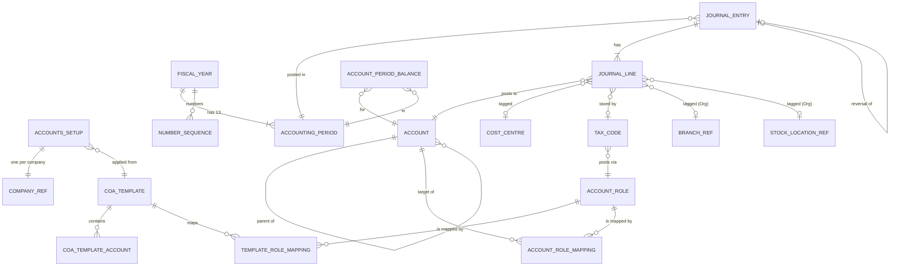

# AC-0 — Accounts: product and architecture plan

**Status:** Draft for Jabran's sign-off, 2026-10-05; updated 2026-10-06 with Jabran's decisions P15–P17 (books belong to the company, books created automatically, no accountant review gate). Nothing here is built, and no contract, migration or code change is approved by this document.
**Owner of the decisions:** the PM-architect (decisions D1–D12, written in below). Where this document disagrees with a decision, it says so in §13 and does not change the decision.
**Rests on:** `NeoERP-Design/RULES.md` (§3, §5, §7, §8), `docs/drafts/step1-accounts-discovery.md` (the gap list), `NeoERP-App/docs/agents/accounts/scope.md` (the earlier scope draft), `docs/drafts/franchise-terms-spec.md` (FT-1, unapproved), `docs/drafts/audit-catalogue.md`, `NeoERP-BackEnd/docs/security/standard-roles.md` (accepted, D-R8), `permission-actions.md`, ADR-005, ADR-010, ADR-012, ADR-013, ADR-015, org `Company` model and `V15__company_region_profile.sql`.
**Supersedes:** the scope draft's slice letters and D-A4 ("no maker-checker in v1"), which conflicts with the accepted D-R8.

---

## 1. Vision and principles

**Vision.** Accounts is the financial book of record for every NeoERP company. Every other module that moves money or value (sales, purchasing, inventory, payroll, POS, franchise charges) ends up as lines in one general ledger, through one posting engine, in a form an auditor in Lahore, Oslo or Stockholm accepts.

**Principles.**

| # | Principle | What it means in practice |
|---|---|---|
| P1 | The ledger is the truth (D2) | Reports read posted lines only. Sub-ledgers (AR, AP, bank) reconcile to their control accounts, never the other way round. |
| P2 | Posted means permanent (D2) | No update or delete on a posted journal or line, enforced in the domain, the API and the database (no UPDATE/DELETE grant on posted rows). Corrections are reversals or new adjusting entries. |
| P3 | One way in (D3) | Only the posting engine writes `journal_*` and balance tables. Modules send posting requests; they never hold ledger credentials. |
| P4 | Post by meaning, not by number (D5) | Modules name an **account role** ("AR control", "Sales tax output"). The company's mapping turns the role into an account. Payroll written once works for a Pakistani textile mill and a Norwegian café. |
| P5 | Defaults that fit, freedom that cannot break (D4) | Every company starts from a tested template. It can extend and rename. It cannot delete or retype a system account or leave a role unmapped. |
| P6 | Ready for more than one currency (D6) | Every line stores transaction currency, amount, rate and base amount from day one. v1 shows one currency. No later data migration. |
| P7 | Company is the wall, branch is a filter (ADR-012/013/015) | Ledger isolation is by company. Branches are dimensions. A franchise is a separate company with its own ledger. Group views need a separate, audited capability. |
| P8 | Two people for money (D-R8, D9) | The author of a manual journal cannot post it. Owner is the audited exception. |
| P9 | Every change has a who and a why (RULES §5) | Every mutation emits an audit event through a transactional outbox; post, reverse, reopen, close, lock carry a reason. |
| P10 | Plain words | Post, Reverse, Close period, Reopen period, Lock period. No "commit", "void" or "finalise". |

---

## 2. Users and personas

Standard roles are the accepted ones in `standard-roles.md` (D-R4 split). Personas map to them one-to-one, except Branch Manager and Neovatus staff.

| Persona | Standard role | Scope | What they do in Accounts | Never |
|---|---|---|---|---|
| **Owner** | Company Owner (`IAM.ORG_ADMIN`) | Company | Everything. Reviews the books and takes them live (Review and go live, P16). Can post own journal (audited Owner exception, D-R8). Reopens periods. Locks years. | Create branches (Neovatus does, RULES §6). |
| **Finance Manager** | `IAM.ACCOUNTS_ADMIN` (renamed) | Company | Reviews the automatically created books and takes them live (P16), maintains chart and role mapping, tax codes, fiscal calendar. Reviews and **posts** journals others wrote. Reverses. Closes, reopens and locks periods. Runs year-end. | Post a journal they wrote. |
| **Accountant** | new (D-R4) | Company | Writes journals (drafts), submits them for posting, prepares period-end entries, reads all reports. Later: drafts invoices, bills, receipts, payments. | Post, reverse, close, reopen, lock, change the chart or role mapping. |
| **Accounts Viewer** | `IAM.ACCOUNTS_VIEWER` | Company | Reads chart, journals and reports. Exports reports. | Change anything. |
| **Auditor** | `IAM.AUDITOR` | Company | Reads everything in Accounts, plus the audit trail and posting evidence (source document, author, poster, reasons). | Change anything. |
| **Branch Manager** | `IAM.BRANCH_MANAGER` | Own branch(es) | Nothing in v1 by default. Later (A3+): reads P&L for own branch only (see Q6). | See other branches' figures or company balance sheet. |
| **Neovatus staff** | Super Admin / Support / Read-only (platform) | Companies in scope, via Enter company | Read-only support inside a company (RULES §13); read-only in Accounts in every Enter company mode (P16). Maintains the platform CoA templates, country packs (with source references, P17) and role catalogue. | Post, reverse or close in a tenant ledger. Change anything in a tenant's Accounts, even with full-access Enter company. Run setup or go live for a company (P16). |

Machine actors (not personas): Payroll, AR/AP (when split out), Inventory, Sales, POS edge, Franchise-charges runner. They hold a machine scope (§6.6) and post on behalf of the human who approved the source document.

---

## 3. Scope: v1 and later, by slice (D12)

v1 = slices **A0–A3** (the ledger) plus **B, C, D, E** (sub-ledgers and tax). F and G follow when their prerequisites are approved. Each slice runs Discovery → Plan → independent review → approval → build → tests → renders → acceptance, per the module loop.

### A0 — Foundation

**Contains:** new V1 schema baseline; platform CoA templates (universal base + PK, NO, SE packs, each item with a source reference, P17); automatic creation of a company's books from Org when module `FINANCE` is enabled (event consumer + retry job, idempotent, P16); one **Review and go live** screen (replaces the setup wizard); fiscal calendar from Org; account-role catalogue and mapping; dimensions (branch, stock location, cost centre); number-sequence table; audit outbox; ADR-012 company-bound repositories; new permission codes.

**Acceptance:**
1. Fresh local DB migrates to the new V1 baseline; old V1–V5 are gone from the accounts schema; no other service's history is touched.
2. Enabling `FINANCE` for the three demo tenants (PK/PKR/July, NO/NOK/January, SE/SEK/January) creates their books with no person involved: the merged chart, every **required** role mapped, FY with periods 1–12 plus 13 at the correct dates, base currency stamped, state "Ready to go live".
3. No books are created (no partial writes) while Org currency or fiscalYearStartMonth is null; Accounts home names the missing fact. Once Org completes it, the books are created by the event or, failing that, by the retry job.
4. A repeated event or retry changes nothing: one set of books per company. Going live twice is refused as "already live".
4a. Nothing can post before go-live, or dated before the go-live date (§5.3). Go live is refused without the acknowledgement, with a required role unmapped, with an invalid role-mapping change, without the fresh effective `ACCOUNTS.SETUP.GO_LIVE` in the company, or by a platform actor; the audit event records actor, time, acknowledgement, chart version and tax pack version.
4b. A relevant Org fact change after the books exist reconciles the company and its old and new parent (§6.1); a repeated or older fact version changes nothing. A lost relationship event (first franchise, removal, move) is repaired by the retry job, because the old and new parent's facts versions also went up.
5. A system account cannot be deleted, retyped, made a header, or deactivated while a role points at it. A role cannot be unmapped.
6. Architecture test: every accounts repository is classified; every tenant-owned method takes `CompanyTenantScope` first. Two-company tests pass for every adapter, including template copy.
7. Every committed domain transition emits exactly one audit event through the outbox, in the same transaction, with reason in the column where required. One request may commit several transitions: go-live with role-mapping changes emits one REMAP per change, then GO_LIVE. A replay emits nothing new; a refused request emits nothing.

### A1 — Journals, posting engine, two-person rule

**Contains:** manual journal (draft, submit, post, reject, reverse); posting-engine API for machines; idempotency; gapless numbering; balance maintenance; D-R8.

**Acceptance:**
1. An unbalanced, empty, single-line, negative or wrong-scale request is refused with field errors; nothing is written.
2. The same idempotency key with the same payload returns the original journal (200, same number). Same key, different payload returns 409.
3. 200 concurrent posts to one company and journal type produce numbers 1..200 with no gap and no duplicate; a rolled-back post consumes no number.
4. Author cannot post own journal, even holding Finance Manager. A different Finance Manager can. Owner can, and the event records `ownerSelfApproval=true`.
5. Posting into a Closed or Locked period is refused, including when the period closes between draft and post (re-checked under lock).
6. Reversal requires a reason, links both ways, and nets the account to zero in TB.
7. Balance tables equal the sum of posted lines after a randomised 10,000-post test.

### A2 — Trial balance, general ledger, period control

**Contains:** TB, GL with opening balance and drill-down; period close, reopen, lock; close checklist.

**Acceptance:**
1. TB total debits = total credits, in base currency, for any period range and any branch filter.
2. GL opening balance for a range equals the sum of all earlier posted lines in that fiscal year plus brought-forward balances; running balance continues from it.
3. Reversed originals and their reversals both appear in GL; TB nets them.
4. Close is refused while submitted drafts exist in the period (warning lists them). Reopen requires Owner or Finance Manager and a reason. Locked cannot reopen, through any API.
5. TB → GL → journal → source document drill-down works in the app.

### A3 — Profit and loss, balance sheet, year-end

**Contains:** P&L, BS (with "result for the year" line), comparative columns, branch and cost-centre filters; year-end close wizard; opening-balance journal type.

**Acceptance:**
1. BS balances (assets = liabilities + equity) for every date, before and after year-end.
2. P&L net result = BS "result for the year" for the same range.
3. Year-end posts one closing journal (type YE) in period 13 moving every income and expense balance to the retained-earnings role. P&L and the `CURRENT_YEAR_RESULT` computation exclude journal type YE, so the closed year's P&L is unchanged; TB offers "before closing" and "after closing". Next year opens with zero P&L balances.
4. Year-end refused if any period 1–12 is still Open or if suspense is non-zero (override with reason by Owner only).
5. Every report reconciles to TB for the same range (automated check).

### B — Receivables

Customers (minimal party record in Accounts until Sales exists), sales invoices, credit notes, receipts, allocation, ageing, customer statement. Posts via roles (AR control, revenue, tax output, rounding). **Acceptance:** AR ageing total = AR control balance at any date; a posted invoice cannot be edited, only credited; receipts allocate across invoices with residual tracking; invoice numbering gapless per company.

### C — Payables

Suppliers, bills, debit notes, payments, allocation, ageing. Mirror of B. **Acceptance:** AP ageing = AP control; bill entered twice (same supplier + supplier invoice number) is refused.

### D — Bank and cash

Bank and cash accounts (ledger accounts flagged as bank, with bank details), receipts and payments, transfers, manual reconciliation against a typed statement. Statement import later. **Acceptance:** reconciled balance + unreconciled items = statement balance; a reconciled line cannot be reversed without un-reconciling (reason).

### E — Tax codes in AR/AP

Tax codes per country pack (PK sales tax, NO MVA, SE moms), applied on invoice and bill lines, posted to output/input roles, tax report by code and period. No filing. **Acceptance:** tax report total per code = tax account movement for the period; line stores applied rate and code version (ADR-010 §5). See §13 C2: tax should move earlier.

### F — Franchise charges

Needs approved franchise terms (FT-1), B and C live, and a machine path for posting into two companies. Franchisor runs per period → drafts → approve → AR invoice in franchisor + AP bill in franchise, as **two independent idempotent postings** with a tracked saga, not one atomic transaction.

### G — Group and consolidation

Franchisor sees own figures plus franchises with `consolidates_into_parent=true`, intra-group charges eliminated, same currency only at first. The flag is reporting only: the franchise never sees the group's figures (P15). The group cash flow adds the companies' cash flow statements together and removes intercompany amounts. Needs the group-scope capability (ADR-013), not a relaxed company scope.

### Later, not slotted

Budgets, fixed assets and depreciation, recurring and allocation journals, accruals with auto-reversal, attachments, bank feeds, cash-flow statement (per company ledger, D10; P15), dashboards, FX revaluation run, tax returns/filing (ADR-010 fiscal providers), SAF-T export (Norway requires SAF-T Financial; Sweden SIE export is customary) — see Q7.

---

## 4. Domain model

### 4.1 Entities

| Entity | Owner | Key fields | Invariants |
|---|---|---|---|
| **CoaTemplate** | Platform | `code`, `version`, `kind` (BASE / COUNTRY / INDUSTRY), `country`, `status` (DRAFT / PUBLISHED / RETIRED) | Published versions are immutable. A country pack names the base version it extends. |
| **CoaTemplateAccount** | Platform | `template_id`, `number`, `name`, `type`, `subtype`, `normal_balance`, `is_header`, `parent_number`, `is_system`, `control_kind`, `currency_rule`, `allowed_dimensions`, `operation` (ADD / RENAME / OVERRIDE / REMOVE for packs), `source`, `evidence_version`, `check_state` (UNCHECKED / CHECKED) | Number unique within template. Packs can only REMOVE non-system base accounts. Source, evidence version and check state are copied into the company's chart provenance (P17). |
| **TemplateRoleMapping** | Platform | `template_id`, `role_code`, `account_number` | Every required role mapped after merge of base + pack. |
| **AccountRole** (catalogue) | Platform | `code`, `name`, `required`, `allowed_types`, `allowed_subtypes`, `control_kind` | Fixed list, extended only by a reviewed migration. |
| **AccountsSetup** | Company | `company_id`, `state` (READY_TO_GO_LIVE / LIVE), `version`, `base_currency`, `fy_start_month`, `template_code+version` applied (chart), `tax_pack+version` applied, `industry_addons`, `org_fact_version` (Org's per-company `factsVersion` last applied), `created_at`, `created_trigger` (FINANCE_ENABLED / ORG_FACTS_COMPLETED / RETRY), `go_live_date`, `went_live_at/by`, `go_live_operation_id` (idempotency key, payload hash), `acknowledgement`, `first_posted_at` | One per company (unique `company_id`; creation once, losers reread the winner, P16). Created by the system, never by a person. No posting while READY_TO_GO_LIVE or dated before `go_live_date`. Go-live, chart replacement and the first posting serialize on this row (§5.3). Base currency immutable after the first posted line. |
| **Account** | Company | `id`, `company_id`, `number`, `name`, `type`, `subtype`, `normal_balance`, `parent_id`, `is_header`, `is_system`, `control_kind` (NONE / AR / AP / BANK / INVENTORY / TAX / PAYROLL / INTERCOMPANY), `currency_rule` (BASE_ONLY / ANY / FIXED:xxx), `allowed_dimensions`, `status`, `template_ref` | Number unique per company. Parent is same company and a header. Header accounts never receive lines. Type cannot change once a line exists. System accounts cannot be deleted, retyped or made header. |
| **AccountRoleMapping** | Company | `company_id`, `role_code`, `account_id`, `effective_from` | Every required role has exactly one active mapping. Target account matches the role's allowed type/subtype and is active and posting. Changes are versioned, never overwritten (history explains old postings). |
| **FiscalYear** | Company | `company_id`, `code` (e.g. FY2026 or FY2026-27), `start_date`, `end_date`, `status` (OPEN / CLOSED / LOCKED) | Contiguous, non-overlapping. 12 months starting at `fy_start_month`. |
| **AccountingPeriod** | Company | `fiscal_year_id`, `number` 1..13, `start_date`, `end_date`, `status` (OPEN / CLOSED / LOCKED), `is_adjustment` | 1–12 cover the year exactly. 13 has the year's last day as both start and end and accepts only adjustment and closing journals. Lock is one-way. |
| **Dimension values** | Company/Org | `branch_id` (Org), `stock_location_id` (Org warehouse), `cost_centre_id` (Accounts), `project_id` (later) | Branch belongs to the company. Stock location belongs to that branch. Cost centre belongs to the company and is active. |
| **CostCentre** | Company | `code`, `name`, `parent_id`, `status` | As today, re-homed on ADR-012 ports. |
| **JournalType** | Platform catalogue | `code` (JV manual, SI sales invoice, SC credit note, PI purchase bill, PD debit note, RC receipt, PY payment, BK bank, PR payroll, IV inventory, FC franchise charge, OB opening balance, RV reversal, YE year-end, FX revaluation), `prefix`, `manual_allowed` | Each source module owns its types. |
| **NumberSequence** | Company | `company_id`, `fiscal_year_id`, `journal_type`, `next_value` | Gapless. Advanced only inside the posting transaction under row lock. |
| **JournalEntry** | Company | `id`, `company_id`, `journal_type`, `number` (null until posted), `draft_ref`, `entry_date`, `period_id`, `status` (DRAFT / SUBMITTED / POSTED), `reversal_of_id`, `reversed_by_id`, `source_module`, `source_document_type`, `source_document_id`, `idempotency_key`, `request_hash`, `memo`, `reason`, `created_by`, `submitted_by`, `posted_by`, `posted_at`, `owner_self_approval`, `header_branch_id` | Posted is immutable. `(company_id, journal_type, fiscal_year, number)` unique. `(company_id, source_module, idempotency_key)` unique. Reversal pair links both ways. "Reversed" is a derived flag (`reversed_by_id` not null), not a status that hides lines. |
| **JournalLine** | Company | `id`, `journal_id`, `company_id`, `line_no`, `account_id`, `role_code` (if posted by role), `side` (DR/CR), `txn_currency`, `txn_amount`, `exchange_rate`, `base_amount`, `branch_id`, `stock_location_id`, `cost_centre_id`, `project_id`, `tax_code_id`, `tax_code_version`, `party_type/party_id` (B/C), `description` | Exactly one side; amounts > 0. Σ base DR = Σ base CR. Σ txn DR = Σ txn CR per currency when all lines share a currency. `company_id` equals the journal's (composite FK). |
| **PostingRequest** | Transient + log | `company`, `source_module`, `source_document_type/id`, `idempotency_key`, `journal_type`, `entry_date`, `lines[]` (account **or** role, side, amounts, currency, rate, dimensions, tax code), `reason`, `requested_by`, `approved_by` | Validated in fixed order (§5.3). Request hash stored with the journal for idempotency. |
| **AccountPeriodBalance** | Company | `company_id`, `account_id`, `period_id`, `branch_id`, `cost_centre_id` (nullable bucket), `txn_currency`, `debit_base`, `credit_base`, `debit_txn`, `credit_txn` | Maintained only by the posting engine, in the same transaction. Equals Σ posted lines (nightly check). |
| **TaxCode** | Company (from the country's tax pack, never from the chart) | `code`, `name`, `kind` (OUTPUT / INPUT / EXEMPT / ZERO / REVERSE_CHARGE / WITHHOLDING / OUT_OF_SCOPE), `rate`, `valid_from`, `valid_to`, `output_role`, `input_role`, optional `output_account` / `input_account` (override where a country splits one role over several accounts, e.g. NO 2700/2701/2702; must pass the role's type check), `report_box`, `jurisdiction` (PK-FED, PK-PB, PK-SD, PK-KP, PK-BA, NO, SE), `tax_pack_version`, `source`, `evidence_version`, `check_state` (UNCHECKED / CHECKED) | Rates versioned, never edited in place (ADR-010 §4). Lines store applied code + version + rate. Tax codes follow the company's Org country; a chart replacement keeps them and remaps their accounts through roles (§6.1). |
| **AuditOutbox / DomainOutbox** | Company | per audit catalogue §5 | Written in the same transaction as the change. |

### 4.2 Account roles catalogue (v1)

`R` = required at setup. Others are mapped when the slice that uses them ships.

The full catalogue is `coa/account-roles.md` (60 roles, the same 20 required). It adds 30 roles the packs need (allowance for doubtful debts, sales returns, service revenue, bank charges, interest, cash over/short, tax settlement, reverse-charge output/input, PK withholding, income tax, pension, holiday pay, other payroll deductions, royalty, marketing fund). Where this table and that file differ, that file wins until the PM rules on the additions (review fix R7).

| Role code | Purpose | Type | R |
|---|---|---|---|
| `AR_CONTROL` | Trade receivables control | Asset / receivable, control AR | R |
| `AP_CONTROL` | Trade payables control | Liability / payable, control AP | R |
| `BANK_DEFAULT` | Default bank | Asset / bank | R |
| `CASH_DEFAULT` | Cash in hand / till float | Asset / cash | R |
| `SALES_TAX_OUTPUT` | Output VAT / sales tax payable | Liability / tax | R |
| `SALES_TAX_INPUT` | Input VAT / sales tax recoverable | Asset or Liability / tax | R |
| `SALES_REVENUE_DEFAULT` | Default sales income | Income | R |
| `PURCHASES_DEFAULT` | Default purchases / cost | Expense | R |
| `COGS` | Cost of goods sold | Expense / cost of sales | R |
| `INVENTORY` | Inventory asset | Asset / inventory | R |
| `GRNI` | Goods received not invoiced | Liability | — (Purchasing) |
| `PAYROLL_EXPENSE` | Salaries and wages | Expense | R |
| `PAYROLL_PAYABLE` | Net pay payable | Liability | R |
| `PAYROLL_TAX_PAYABLE` | Withholding tax on salaries (PK), forskuddstrekk (NO), personalskatt (SE) | Liability | R |
| `EMPLOYER_CONTRIB_PAYABLE` | EOBI and provincial social security, e.g. PESSI/SESSI (PK), arbeidsgiveravgift (NO), arbetsgivaravgifter (SE) | Liability | R |
| `EMPLOYER_CONTRIB_EXPENSE` | Employer contributions cost | Expense | R |
| `RETAINED_EARNINGS` | Accumulated result | Equity | R |
| `CURRENT_YEAR_RESULT` | BS presentation line for the open year (see §13 C5) | Equity, system, no direct posting | R |
| `OPENING_BALANCE_EQUITY` | Contra for opening balances at go-live | Equity | R |
| `SUSPENSE` | Unresolved items; must be zero at year-end | Asset or Liability | R |
| `ROUNDING` | Currency rounding differences | Expense / Income | R |
| `FX_REALIZED_GAIN` / `FX_REALIZED_LOSS` | Realised exchange differences | Income / Expense | — (multi-currency) |
| `FX_UNREALIZED_GAIN` / `FX_UNREALIZED_LOSS` | Revaluation | Income / Expense | — (multi-currency) |
| `CUSTOMER_ADVANCES` | Payments received before invoice | Liability | — (B) |
| `SUPPLIER_ADVANCES` | Prepayments to suppliers | Asset | — (C) |
| `DISCOUNT_GIVEN` / `DISCOUNT_RECEIVED` | Settlement discounts | Expense / Income | — (B/C) |
| `BAD_DEBT_EXPENSE` | Write-offs | Expense | — (B) |
| `FRANCHISE_FEE_INCOME` | Franchisor's fee income | Income | — (F) |
| `FRANCHISE_FEE_EXPENSE` | Franchise's fee cost | Expense | — (F) |
| `INTERCOMPANY_RECEIVABLE` / `INTERCOMPANY_PAYABLE` | Balances with franchisor/franchises | Asset / Liability, control INTERCOMPANY | — (F/G) |
| `INVENTORY_ADJUSTMENT` | Stock count differences, shrinkage | Expense | — (Inventory) |
| `POS_CASH_CLEARING` / `CARD_CLEARING` | Till and card settlement clearing | Asset | — (POS) |

### 4.3 Templates: how the default chart is built

- **One class structure for everyone.** The universal base uses the 1–8 class layout shared by NS 4102 and BAS: 1 assets, 2 equity and liabilities, 3 operating income, 4 cost of goods, 5 payroll, 6–7 other operating costs, 8 financial items, tax and result. Four-digit numbers. This makes Norway and Sweden packs mostly renames and additions, and gives Pakistan a familiar, IFRS-aligned grouping (Pakistan has no statutory chart).
- **Packs overlay the base**: ADD accounts, RENAME (local language name kept as `name_local`), OVERRIDE subtype or tax mapping, REMOVE optional base accounts. Packs carry their role-mapping overrides.
- **Chart structure and tax jurisdiction are separate.** Tax codes come from a tax pack chosen by the company's Org country, never by the chart. A Pakistan company on the Norway or Base chart keeps Pakistan's tax codes; their accounts are found through roles in whichever chart is in use. Chart version and tax pack version are recorded separately.
- **Every pack account and tax code** carries `source` (official reference), `evidence_version` and `check_state` (UNCHECKED / CHECKED). Required-account panels show "Not yet checked against source" until CHECKED (P17).
- **As drafted** (`coa/README.md` CA1): only PK is an overlay. NO and SE ship as complete charts on the same 1–8 class skeleton, because their numbers differ from the base too often for renames. The loader stores both shapes the same way after merge. Needs PM sign-off (review fix R8).
- **Industry add-ons** (retail, manufacturing/textile, services) are later overlays of the same shape.
- **Copy, then own.** Creating the books (P16) merges base + pack (+ add-ons) and copies the result into the company with a `template_ref` per account. The company's chart never changes when Neovatus publishes a new template version. A later "template update available" compare-and-apply flow mirrors the standard-roles P-7 model.
- **Storage** is separate platform-reference tables behind `@PlatformReferenceRepository` (ADR-012 rule: no nullable or zero-UUID `company_id` mixing templates with tenant rows — the old V5 seed did exactly that).

### 4.4 ERD



Every company-owned table carries `company_id`; child tables carry it too and use composite foreign keys `(company_id, parent_id)` so a line can never point at another company's account, period or journal.

---

## 5. Posting engine

### 5.1 Shape

One application service, `PostingEngine.post(scope, request): PostedJournal`, inside accounts-service. Three callers:

| Caller | Path | Two-person |
|---|---|---|
| Manual journal (Accountant → Finance Manager) | `POST /api/accounts/journals/{id}/post` → engine | Yes: poster ≠ author (Owner exception, audited) |
| Module machine client (Payroll, AR, AP, Inventory, POS, Franchise) | `POST /api/accounts/postings` with machine scope | Approval evidence from the source module is required (`approvedBy`); see §13 C1 |
| Accounts' own sub-ledgers (B–E, in-process) | direct call to the engine | Document's own approve step (author ≠ approver) |

### 5.2 Request (indicative)

```json
{
  "companyId": "…",
  "sourceModule": "PAYROLL",
  "sourceDocumentType": "PAYROLL_RUN",
  "sourceDocumentId": "…",
  "idempotencyKey": "PAYROLL_RUN:…:v1",
  "journalType": "PR",
  "entryDate": "2026-10-31",
  "memo": "Payroll October 2026",
  "reason": "Approved payroll run",
  "requestedBy": "kc-subject-…",
  "approvedBy": "kc-subject-…",
  "lines": [
    { "role": "PAYROLL_EXPENSE", "side": "DR", "currency": "PKR", "amount": "1250000.0000", "branchId": "…", "costCentreId": "…" },
    { "role": "PAYROLL_PAYABLE", "side": "CR", "currency": "PKR", "amount": "1100000.0000", "branchId": "…" },
    { "role": "PAYROLL_TAX_PAYABLE", "side": "CR", "currency": "PKR", "amount": "150000.0000", "branchId": "…" }
  ]
}
```

Amounts are decimal **strings**. `rate` is omitted when currency = base (rate 1). A line has `role` or `accountId`, never both.

### 5.3 Validation order (fail fast, no writes before step 10)

1. **Authority.** Resolve `CompanyTenantScope` with a fresh authority decision (ADR-012: money-authoritative). Human: permission + entitlement + active membership; platform actors refused (READ_ONLY and full-access Enter company, P16). Machine: scope `accounts.posting.write` + module entitled + `sourceModule` allowed for that client.
2. **Idempotency.** Look up `(company, sourceModule, idempotencyKey)`. Found with same `request_hash` → return the existing journal, 200, no new event. Found with different hash → 409 `IDEMPOTENCY_CONFLICT`. In-flight duplicate → blocked by the unique index; loser re-reads and returns the winner.
3. **Structure.** ≥ 2 lines; ≤ 1,000 lines; each line one side, amount > 0, scale ≤ currency scale (PKR/NOK/SEK = 2) for txn and 4 in storage; known journal type; manual-only types not from machines and vice versa.
4. **Roles → accounts.** Resolve each role through the mapping effective on `entryDate`. Unmapped role → 422 `ROLE_UNMAPPED` (names the role).
5. **Accounts.** Same company, active, posting (not header), currency rule satisfied, dimensions allowed. Control accounts: only the owning sub-ledger may post (manual JV to AR control refused unless Owner/Finance Manager sets `allowControlPosting` with reason — rare and audited).
6. **Dimensions.** Branch required on every line, defaulted from the journal header (every company has at least Head Office). Branch is active and belongs to the company (Org facts cache, §6.1). Stock location belongs to the branch. Cost centre active. Invalid dimension → 422 with line index.
7. **Currency.** Base currency from `AccountsSetup`. v1: txn currency must equal base (feature flag `MULTI_CURRENCY` off). Base amount = round(txn × rate, base-currency scale, HALF_UP). Rounding mode lives on the currency record, so a country can differ without code. Balance check first on transaction amounts per currency: any difference → 422 `UNBALANCED` (no tolerance, so a manual journal can never be auto-balanced). Then on base amounts: a residual that comes only from converting balanced foreign-currency lines, within tolerance (≤ one minor unit × number of foreign-currency lines), goes to `ROUNDING` as an engine-added line; above tolerance → 422 `UNBALANCED`. With `MULTI_CURRENCY` off (rate 1) the residual is always zero.
7a. **Books live.** `AccountsSetup.state = LIVE` (else 409 `BOOKS_NOT_LIVE`) and `entryDate >= go_live_date` (else 422 `BEFORE_GO_LIVE`). Checked here to fail fast and re-checked under lock in step 10.
8. **Period.** Find period for `entryDate` (period 13 only when `journalType` is OB, YE or an adjustment flagged by Finance Manager). Status must be OPEN.
9. **Two-person.** Manual: `actor ≠ created_by` unless actor holds Owner → `owner_self_approval = true`. Machine: `approvedBy` present and is not the system actor.
10. **Write**, in one DB transaction (READ COMMITTED). Lock order: setup row → period → journal sequence, on every posting path (manual, machine, in-process):
    1. Lock the company's `accounts_setups` row: `FOR UPDATE` (or a version check) for the first posting, which sets `first_posted_at`; later postings may take it `FOR SHARE`. Go-live and chart replacement take it `FOR UPDATE`, so they serialize with the first posting. Re-check LIVE and `entryDate >= go_live_date`.
    2. `SELECT … FROM accounting_periods WHERE id = ? FOR SHARE` and re-check OPEN.
    3. `SELECT … FROM number_sequences WHERE (company, fy, type) FOR UPDATE`, take `next_value`, increment.
    4. Insert journal (POSTED, number), lines.
    5. Upsert `account_period_balances` rows in **sorted key order** (prevents deadlocks).
    6. Insert idempotency record (the unique constraint is on the journal itself).
    7. Insert audit outbox event (`accounts-journal / POST`) and domain outbox event (`journal.posted`).
    8. Commit. Return `{ journalId, number, period, status, lines with resolved accounts }`.

    A refusal at any step allocates no journal number and writes no journal, balance, audit or event.

**Regression cases (live guard):** a posting while the books are READY_TO_GO_LIVE is refused; a posting dated before the go-live date is refused; a chart replacement concurrent with the first posting lets exactly one win and the other is refused with no number used. Each case checks that no journal, number, balance, audit or event was written.

### 5.4 Concurrency and locking

| Contention | Mechanism | Effect |
|---|---|---|
| Post vs go-live / chart replacement | Setup row locked first (§5.3 step 10.1); go-live and chart replacement take `FOR UPDATE` | The first posting and a chart replacement never interleave; nothing posts before LIVE or before the go-live date. |
| Post vs period close | Post holds `FOR SHARE` on the period row; close takes `FOR UPDATE` | Close waits for in-flight posts, then no new post can see OPEN. Fixes the discovery's "closed between create and post" gap. |
| Gapless number | Row lock per (company, fiscal year, journal type) | Serialises posts of one type in one company. Measured cost: one row lock for the transaction length (~10–30 ms). Separate types do not block each other. |
| Balance rows | Upsert in sorted order | No deadlock; hot rows (e.g. AR control in the current period) serialise per branch + cost centre bucket. |
| High-volume POS | POS posts a **daily (or shift) summary** per store, not per receipt | Keeps ledger volume sane; receipt detail stays in POS/fiscal journal (ADR-010). |

### 5.5 Balance maintenance

- `account_period_balances` is the only aggregate. TB = sum over periods; GL opening = balances before range + lines within range.
- **Brought-forward:** year-end posts closing journal in period 13; balance-sheet accounts (ASSET, LIABILITY, EQUITY) carry forward by query (sum of all earlier fiscal years' balance rows), not by a second "opening" posting. INCOME and EXPENSE accounts always open a fiscal year at zero, whether or not the prior year is closed. Only go-live opening balances use an OB journal.
- **Prior year not yet closed:** companies keep posting in the new year before year-end runs. Until it runs, the balance sheet shows the unclosed years' result as a computed equity line ("Result of prior years not yet closed"), next to `CURRENT_YEAR_RESULT`, so the balance sheet balances on every date. Year-end then moves it into `RETAINED_EARNINGS` and the computed line drops to zero.
- **Nightly reconciliation job** recomputes Σ lines vs balance rows per company/period; any difference raises an ops alert and a company-visible "ledger check failed" banner for Finance Manager. It never self-heals silently; repair is a reviewed admin operation.

### 5.6 Reversal

- `POST /journals/{id}/reverse { reason, reversalDate? }` → engine creates journal type RV (or the source module's own reversal type) with every line swapped, same dimensions and tax codes, links `reversal_of_id` / `reversed_by_id`.
- Date: given date, else original date if its period is OPEN, else first day of the earliest OPEN period after it. Locked or closed → refused unless a date in an open period is supplied.
- A journal can be reversed once. A reversal cannot be reversed (post a new journal instead).
- A year-end closing journal (YE) cannot be reversed from the journal screen. Undoing a year-end is a separate "reopen year" operation (Owner, reason, not in v1) that reverses YE and reopens period 13 together.
- Sub-ledger documents (invoice, bill) are not reversed from the journal screen; they are credited/cancelled in their module, which posts its own reversal through the engine.

### 5.7 Manual journal lifecycle and two-person flow

```
DRAFT --submit--> SUBMITTED --post (other person)--> POSTED --reverse (reason)--> POSTED + linked RV
  ^                   |
  +----reject (reason)+
DRAFT --delete--> (gone; drafts only)
```

- Draft carries `draft_ref` (`JV-DRAFT-000045`), not a legal number.
- Submit freezes the content; edits require reject back to draft.
- Owner may post without submit (single-person company), recorded as `owner_self_approval`.
- "Waiting for you to post" queue lists SUBMITTED journals the viewer did not author.

### 5.8 Failure modes

| Failure | Behaviour |
|---|---|
| DB error / timeout mid-transaction | Full rollback; no number used; caller retries with the same key and gets one journal. |
| Caller retries after a successful but lost response | Idempotent replay returns the same journal. |
| Org unavailable (dimension or currency check) | Fresh-authority money operation fails closed: 503 `ORG_UNAVAILABLE`, retryable. Org facts cache may serve branch existence for ≤ 5 min, never for currency or setup. |
| IAM authz unavailable | Fail closed (ADR-012 §2). |
| Audit-service down | Outbox holds the event; dispatcher retries with backoff; posting is unaffected. |
| Role mapping changed between draft and post | Draft keeps the role; resolution happens at post with the mapping effective on `entryDate`. The posted line stores both role and account. |
| Period closed while a machine retries | 422 `PERIOD_CLOSED` with the period; source module shows "needs a date in an open period" and keeps its document in an error state. Never silently re-dated. |
| Balance check failure (nightly) | Alert + banner; posting continues; reviewed repair. |
| Sequence row missing for a new year | Created inside the same transaction with `INSERT … ON CONFLICT DO NOTHING` then locked. |

---

## 6. Integration contracts with other modules

### 6.1 Org (company facts, branches, locations)

| Need | Source | Rule |
|---|---|---|
| Base currency | `companies.currency` (V15, D-13) | Read when the books are created and stamped on `AccountsSetup`. Null → no books yet; Accounts home says "Ask Neovatus to complete the company's country and currency", and the books are created once it is set (P16). Accounts never guesses. Base currency cannot change after the first posted line; an Org change afterwards is ignored by Accounts and flagged to Finance Manager. |
| Fiscal year start | `companies.fiscal_year_start_month` | Read when the books are created and when creating each new fiscal year. Change after first posting requires a reviewed "change fiscal year" operation (short transition year). Not in v1. |
| Country / pack | `companies.country` → chart pack and tax pack (PK, NO, SE) | Picks the chart and, separately, the tax pack. The chart can be replaced before the first posting; the tax pack always follows the country. Unknown country → base chart and no tax pack, with a warning. |
| Branches, stock locations | org-service, machine scope `org.facts.read` | Accounts keeps a read-through cache keyed by company (TTL 5 min, evicted on Org domain events when those exist). Validation only; Accounts stores ids, never names as truth. |
| Franchise relationship | `company_type`, `parent_company_id`, `consolidates_into_parent` | Read when the books are created and reconciled on every relevant Org change (below), to switch franchise and group accounts (P15), and by F and G. A franchise is always its own company with its own books; branches never have books of their own. `consolidates_into_parent` is a reporting flag only. Never used to widen `CompanyTenantScope`. |
| Entitlement | module `FINANCE`, features `RECEIVABLES`, `PAYABLES`, `MULTI_CURRENCY`, `TAX_FILING_PK` | Checked per request (existing `AccountsModuleAccessClient`). `FINANCE` becoming enabled (agreement or entitlement change, or company created with it on) is an org-service event that accounts-service consumes to create the books (P16); Org fact changes are consumed the same way. A retry job covers missed events. New features for later slices are added to the catalogue in the same change as their codes. |

**Creation and reconciliation are separate.**

- *Initial creation* happens once per company: a uniqueness constraint on `company_id`, concurrent losers reread the winner, no extra audit.
- *Company-facts version.* org-service keeps one aggregate `factsVersion` per company. It advances when the company's own facts change, and when its relationship set changes: a franchise added under it, removed or moved away, or a child's `consolidates_into_parent` flag. A relationship change advances the child's version and the old and new parent's versions in the same transaction. The outbox event carries `companyId`, `factsVersion`, `oldParentId`, `newParentId`. org-service keeps relationship history (parent, from, to), so a missed removal or move can still name the former parent. The facts contract returns the current facts plus `factsVersion`.
- *Company-facts reconciliation* is versioned. On an Org fact event Accounts reconciles the company and its old and new parent. For each, it reads current facts and `factsVersion` and applies only if newer than the stored `org_fact_version`. It recomputes the system-switched accounts (switched by company type) from current facts only, so a missed event for the old parent is repaired once that parent's version is seen. Accounts a person switched, the chart and the go-live state are kept. Each applied version records one audit transition (`accounts-setup RECONCILE`) with that version. A duplicate or older version is a no-op.
- *Retry job*: bounded and cursor-based. It scans companies with `FINANCE` on and no books (created once facts are complete), and books whose stored `org_fact_version` is lower than Org's aggregate `factsVersion`.
- *Acceptance cases*: a lost first-franchise event (the parent's franchise income accounts switch on through the retry job); a lost removal or move (the old parent's switch off if it has no franchise left, the new parent's switch on); duplicate or older events are no-ops; accounts a person switched and the go-live state are never touched; one audit per applied version.

**Dependencies on org-service and platform.** Items 1 and 2 are org-service work that must land before or with A0.

1. A versioned machine Org-facts contract for Accounts: currency, fiscal year start, consolidation, company type and parent, company-bound branch, location and franchise enumeration, and an eligible-company cursor. It returns current facts plus the company's aggregate `factsVersion` (above), and org-service keeps relationship history. Accounts never reads another service's database.
2. org-service publishes domain events through a transactional outbox: `FINANCE` effective enablement and disable (from agreement, entitlement and enrolment) and company fact changes, each with event id, `companyId`, `factsVersion`, `oldParentId` and `newParentId`, safe to redeliver. The audit outbox is not this.
3. Platform actors are refused on every Accounts write, in READ_ONLY and FULL Enter company modes.
4. Go-live and chart replacement require the fresh effective permission `ACCOUNTS.SETUP.GO_LIVE` / `ACCOUNTS.CHART.REPLACE` in that company. Seeded by default only for Owner and Finance Manager; a custom role or an Extra that grants the code is allowed (whoever holds the code; that is the RBAC model). Taken away wins. Platform actors are refused in every mode. Identity comes from the token user and server-side membership, never from client claims.
5. A setup preflight endpoint returns NOT_ENABLED / FACTS_MISSING / CREATING / READY / LIVE without exposing ledger data, reachable when `FINANCE` is off.
6. ADR-012 company binding everywhere; franchise and consolidation never widen the scope. 409 for state and version conflicts, 422 for field and domain refusals, 401 and 403 distinct.

### 6.2 IAM

- Permissions and standard-role defaults ship in a **user-service migration** (new version number at implementation time) that seeds the Accounts manifest in §7 and maps old codes per permission-actions rule 7. user-service history is not reset.
- D-R8 is enforced in accounts-service (author/poster identity from the token subject), not by permissions alone.
- Owner detection uses the effective-roles answer from `/api/authz/effective`, not a token claim.

### 6.3 Modules posting through roles

| Module | Source document | Journal type | Roles used | Trigger |
|---|---|---|---|---|
| Payroll | Approved payroll run | PR | PAYROLL_EXPENSE, PAYROLL_PAYABLE, PAYROLL_TAX_PAYABLE, EMPLOYER_CONTRIB_* | Run moves to POSTED in Payroll (two-person already done there) |
| Payroll (payment) | Salary payment batch | PY | PAYROLL_PAYABLE, BANK_DEFAULT | Payment confirmed |
| AR (B) | Invoice, credit note, receipt | SI, SC, RC | AR_CONTROL, SALES_REVENUE_*, SALES_TAX_OUTPUT, BANK/CASH, DISCOUNT_GIVEN | Document approved |
| AP (C) | Bill, debit note, payment | PI, PD, PY | AP_CONTROL, PURCHASES_*, SALES_TAX_INPUT, BANK | Document approved |
| Inventory (later) | Goods receipt, issue, adjustment, count | IV | INVENTORY, GRNI, COGS, INVENTORY_ADJUSTMENT | Movement confirmed |
| POS (later) | Store day/shift close | SI (summary) | CASH, CARD_CLEARING, SALES_REVENUE, SALES_TAX_OUTPUT, ROUNDING | Z-close |
| Franchise (F) | Approved charge run | FC | Franchisor: AR_CONTROL/INTERCOMPANY_RECEIVABLE, FRANCHISE_FEE_INCOME, tax; Franchise: FRANCHISE_FEE_EXPENSE, AP_CONTROL/INTERCOMPANY_PAYABLE, tax | Two postings, two companies, one saga id |

**Contract rules for every producer**

1. Idempotency key = `SOURCE_TYPE:sourceDocumentId:revision`. The producer stores the returned journal id and number on its document.
2. Producer calls from its own outbox (retry until 2xx or a 4xx it must show to a person). Never fire-and-forget.
3. Corrections: the producer sends a reversal request referencing the original journal id, then a new posting. It never asks Accounts to edit.
4. The producer sends `approvedBy` (sign-in subject of the human approver) and `reason`. Accounts records it as the poster of record; the machine client id is recorded as `producerClientId`.
5. A producer never reads ledger tables. It may read its own posting status via `GET /api/accounts/postings/{sourceModule}/{idempotencyKey}`.

### 6.4 Audit

- New accounts-service outbox table + dispatcher, copied from the org-service pattern (reason and amendment reference **columns**, not payload only).
- Resources: `accounts-setup`, `accounts-account`, `accounts-role-mapping`, `accounts-fiscal-year`, `accounts-period`, `accounts-journal`, `accounts-cost-centre`, `accounts-tax-code`, later `accounts-invoice`, `accounts-bill`, `accounts-receipt`, `accounts-payment`, `accounts-bank-reconciliation`.
- Actions: `CREATE`, `UPDATE`, `DEACTIVATE`, `ACTIVATE`, `DELETE` (drafts), `SUBMIT`, `REJECT`, `POST`, `REVERSE`, `CLOSE`, `REOPEN`, `LOCK`, `RUN` (year-end), `GO_LIVE` (books), `CHART_REPLACE` (chart before the first posting, reason), `RECONCILE` (Org facts, system), `REMAP` (role mapping). Books created automatically are `accounts-setup CREATE` with actor `system` and the trigger (P16). Every `accounts-setup` event records actor (system or user), company, trigger, fact version, chart version, tax pack version, go-live date, acknowledgement and correlation or idempotency id, as they apply. Published only after commit; a replay writes no duplicate.
- Reason required (catalogue §6.7): post, reverse, reject, close, reopen, lock, year-end, role remap, account deactivate, control-account override. Not for draft create/edit or ordinary account create.
- Payload: journal id, number, type, date, period, total, line count, source document; never full line detail (the ledger is the record).
- Wording entries added to `AuditWording` in the same change.

### 6.5 Domain events (for later consumers)

`accounts.journal.posted`, `accounts.journal.reversed`, `accounts.period.closed`, `accounts.period.reopened`, `accounts.period.locked`, `accounts.books.created`, `accounts.books.went_live`, `accounts.books.reconciled`. Published from the domain outbox, only after commit; a replay publishes no duplicate. v1 has no consumer; the table exists so producers (Payroll, POS) can react to period close later.

### 6.6 Machine scopes

| Scope | Holder | Allows |
|---|---|---|
| `accounts.read` / `accounts.write` | Gateway (human calls) | As today; human permission still checked per action |
| `accounts.posting.write` (new) | payroll-service, later inventory, sales, pos-edge, franchise runner | `POST /api/accounts/postings`, reversal requests, status read — only for the `sourceModule`s registered for that client |
| `org.facts.read` | accounts-service | Company facts, branches, locations |
| `audit.event.write` | accounts-service | Audit dispatcher |

---

## 7. Security and isolation

### 7.1 Permission codes (one per action)

Existing names kept where they already exist in `permission-actions.md`; new ones in **bold**.

| Record | Codes |
|---|---|
| Setup | **`ACCOUNTS.SETUP.GO_LIVE`** (review and go live, once per company), **`ACCOUNTS.CHART.REPLACE`** (replace the chart before the first posting, reason). Creating the books is system-only; no person holds a code for it (P16). Both codes are checked fresh and effective in that company. Seeded by default only for Owner and Finance Manager; a custom role or an Extra that grants the code is allowed. Taken away wins; platform actors are refused in every mode; identity from the token user and server-side membership, never client claims. |
| Chart of accounts | `ACCOUNTS.COA.READ`, `.CREATE`, `.UPDATE`, `.DEACTIVATE` (`COA.COPY_TEMPLATE` retired; books creation is system-only) |
| Account roles | **`ACCOUNTS.ROLE_MAPPING.READ`**, **`ACCOUNTS.ROLE_MAPPING.UPDATE`** (reason) |
| Cost centre | `ACCOUNTS.COST_CENTER.READ`, `.CREATE`, `.UPDATE`, `.DEACTIVATE` |
| Fiscal year | `ACCOUNTS.FISCAL_YEAR.READ`, `.CREATE`, `.CLOSE` (year-end, reason), **`.LOCK`** (reason) |
| Period | `ACCOUNTS.PERIOD.READ`, `.CLOSE` (reason), **`.REOPEN`** (reason), `.LOCK` (reason) |
| Journal | `ACCOUNTS.JOURNAL.READ`, `.CREATE`, `.UPDATE`, `.DELETE` (drafts), **`.SUBMIT`**, **`.REJECT`** (reason), `.POST` (reason), `.REVERSE` (reason) |
| Tax code | **`ACCOUNTS.TAX_CODE.READ`**, **`.CREATE`**, **`.UPDATE`** (new version), **`.DEACTIVATE`** |
| Reports | `ACCOUNTS.REPORT.GL`, `ACCOUNTS.REPORT.TRIAL_BALANCE`, **`ACCOUNTS.REPORT.PROFIT_LOSS`**, **`ACCOUNTS.REPORT.BALANCE_SHEET`**, **`ACCOUNTS.REPORT.TAX`**, **`ACCOUNTS.REPORT.EXPORT`** |
| B–D (later) | `ACCOUNTS.CUSTOMER.*`, `.INVOICE.{READ,CREATE,UPDATE,DELETE,APPROVE,CREDIT}`, `.RECEIPT.*`, `.SUPPLIER.*`, `.BILL.*`, `.PAYMENT.{…,APPROVE}`, `.BANK_ACCOUNT.*`, `.BANK_RECONCILIATION.{READ,RECONCILE,UNRECONCILE}` |
| F, G | `ACCOUNTS.FRANCHISE_CHARGES.{READ,RUN,APPROVE}`, `ACCOUNTS.REPORT.GROUP` |
| Platform parity | `PLATFORM.ACCOUNTS_TEMPLATE.{READ,PUBLISH}` (Neovatus template maintenance) |

`ACCOUNTS.PERIOD.CREATE/UPDATE` and `FISCAL_YEAR.UPDATE` from the earlier catalogue are retired: periods are generated, never typed (D7).

### 7.2 Defaults per standard role (A0–A3)

| Code | Owner | Finance Mgr | Accountant | Accounts Viewer | Auditor | Company Admin | Branch Mgr |
|---|---|---|---|---|---|---|---|
| `SETUP.GO_LIVE`, `CHART.REPLACE` | ✓ | ✓ | — | — | — | — | — |
| `COA.READ`, `ROLE_MAPPING.READ`, `COST_CENTER.READ`, `FISCAL_YEAR.READ`, `PERIOD.READ`, `TAX_CODE.READ` | ✓ | ✓ | ✓ | ✓ | ✓ | — | — |
| `COA.CREATE/UPDATE/DEACTIVATE`, `COST_CENTER.*` writes, `TAX_CODE.*` writes | ✓ | ✓ | — | — | — | — | — |
| `ROLE_MAPPING.UPDATE` | ✓ | ✓ | — | — | — | — | — |
| `FISCAL_YEAR.CREATE` | ✓ | ✓ | — | — | — | — | — |
| `PERIOD.CLOSE`, `PERIOD.REOPEN` | ✓ | ✓ | — | — | — | — | — |
| `PERIOD.LOCK`, `FISCAL_YEAR.CLOSE`, `FISCAL_YEAR.LOCK` | ✓ | ✓ | — | — | — | — | — |
| `JOURNAL.READ` | ✓ | ✓ | ✓ | ✓ | ✓ | — | — |
| `JOURNAL.CREATE/UPDATE/DELETE/SUBMIT` | ✓ | ✓ | ✓ | — | — | — | — |
| `JOURNAL.REJECT`, `JOURNAL.POST`, `JOURNAL.REVERSE` | ✓ | ✓ | — | — | — | — | — |
| `REPORT.GL/TRIAL_BALANCE/PROFIT_LOSS/BALANCE_SHEET/TAX` | ✓ | ✓ | ✓ | ✓ | ✓ | — | later B (Q6) |
| `REPORT.EXPORT` | ✓ | ✓ | ✓ | ✓ | ✓ | — | — |

Company Admin gets nothing in Accounts (D-R1: no money). Owner receives every new code automatically (standard-roles rule 4).

### 7.3 Isolation (ADR-012) from the first slice

- Every accounts repository is `@TenantOwnedRepository` with `CompanyTenantScope` first, except template/catalogue repositories (`@PlatformReferenceRepository`, on the reviewed allowlist). The rebuilt service starts with an **empty** Accounts baseline allowlist — this *is* ADR-012 Phase 1 for Accounts.
- By-id queries are `(company_id, id)`; child tables carry `company_id` with composite FKs.
- Company comes from the authenticated scope. A `companyId` in a body or query is input to the resolver, never authority. Record actions derive the company from the record **through** the scoped query.
- Platform staff: read-only in Accounts in every Enter company mode (P16). READ_ONLY writes are refused by the existing lifecycle filter; accounts-service also refuses every write from full-access Enter company, independently of permission checks.
- Two-company contract test per adapter, including balances, reports and template copy.
- RLS (ADR-012 Phase 4) prototyped first on `journal_lines` and `account_period_balances` after A2.
- DB grants: application role has no UPDATE/DELETE on posted journal rows (trigger refuses UPDATE when `status = POSTED` except setting `reversed_by_id`).

---

## 8. Data and migrations

### 8.1 New baseline

- accounts-service Flyway history **restarts**: delete `V1__…`–`V5__…`, add a new `V1__accounts_baseline.sql` (schema, tables, constraints, triggers) and `V2__seed_platform_templates.sql` (account-role catalogue, journal types, currencies, base template, PK/NO/SE packs, tax-code templates). Later slices add V3+ normally.
- Allowed only because nothing is in production (D1). After the first non-local deployment, history is frozen like every other service.
- Tables (A0–A3): `currencies`, `account_roles`, `journal_types`, `coa_templates`, `coa_template_accounts`, `coa_template_role_mappings`, `tax_code_templates`, `accounts_setups`, `accounts`, `account_role_mappings`, `cost_centres`, `tax_codes`, `fiscal_years`, `accounting_periods`, `number_sequences`, `journal_entries`, `journal_lines`, `account_period_balances`, `audit_outbox`, `domain_outbox`.
- Types: amounts `NUMERIC(19,4)`, rates `NUMERIC(19,9)`, currency `CHAR(3)` ISO 4217, ids UUID, timestamps `TIMESTAMPTZ`, dates `DATE`.

### 8.2 Local reset plan (to be written as a runbook in the implementation step)

1. Stop accounts-service.
2. `DROP SCHEMA accounts CASCADE; CREATE SCHEMA accounts;` on `neoerp_accounts` (local and shared dev only).
3. Start accounts-service; Flyway applies the new V1, V2.
4. Run the user-service permission migration (new version, forward-only) that replaces old `ACCOUNTS.*` codes and grants defaults.
5. Re-run demo seed: enable `FINANCE` for the PK, NO and SE demo tenants so their books are created through the normal event path, then go live through the API (not SQL), so audit and outbox paths are exercised.
6. `scripts/` gets a `reset-accounts-local` script; `docs/local-demo-data.md` gets the steps. CI uses a fresh container per run anyway.

### 8.3 Seeded templates (built by the team from official sources, P17)

| Template | Basis | Approx. accounts | Notes |
|---|---|---|---|
| `BASE` v1 | IFRS-aligned, classes 1–8 | 188 posting + 61 headers | English names; all 60 roles mapped |
| `PK` v1 | Base + Pakistan practice (overlay) | 205 posting + 61 headers | PKR, FY July; federal sales tax 18%, provincial services tax (Sindh, Punjab…), WHT payable accounts, EOBI/PESSI |
| `NO` v1 | NS 4102 class and group structure (complete chart) | 183 posting + 63 headers | NOK, FY January; MVA codes 25/15/12/0, arbeidsgiveravgift, feriepenger, Norwegian names in `name_local` |
| `SE` v1 | BAS class and group structure (complete chart) | 196 posting + 67 headers | SEK, FY January; moms 25/12/6/0, arbetsgivaravgifter, semesterlöneskuld, Swedish names in `name_local` |

Templates are authored as versioned data files in the repo (reviewed like code), loaded by the seed migration; never edited in a running DB. Each tax code and each required account carries a source reference to the official document, with `evidence_version` and `check_state`: Pakistan FBR and the provincial authorities (PRA, SRB, KPRA, BRA); Norway Skatteetaten MVA codes and the SAF-T standard tax codes; Sweden Skatteverket and the public BAS structure. Automated tests check every rate against a versioned rates table. An item not yet checked against its source shows "Not yet checked against source". A fix is a new pack version and never touches a company's books. The first customer in each country is a pilot before the country is called ready (P17). Drafts: `docs/drafts/accounts/coa/` (generated from `_generator/`, 44 tax codes in `tax-codes.csv`).

---

## 9. API outline

Base `/api/accounts`. Actions are `POST …/{id}/{verb}`, updates are `PATCH` (keeps the discovered backend convention). Money as decimal strings. Pages as `{items, page, size, totalElements}` everywhere. Errors use the shared `fieldErrors` shape (reason under `fieldErrors.reason`).

| Resource | Key endpoints |
|---|---|
| Templates (read) | `GET /templates`, `GET /templates/{code}/versions/{v}/preview?pack=NO&addons=retail` |
| Setup | `GET /setup` (state, Org facts check, missing facts, `goLive: { operationId, actorId, actorName, at, date, chartVersion, taxPackVersion }` or null before go-live; preflight reachable when `FINANCE` is off, no ledger data), `POST /setup/go-live` with `Idempotency-Key` {goLive, accountsOn[], accountsOff[], chart?, chartVersion?, chartReason?, mappingChanges: [{roleCode, accountCode, reason}], taxPackVersion, acknowledged} (same key + same payload replays the stored success; same key + different payload → 409 `IDEMPOTENCY_KEY_REUSED` whose body includes the original operation's result; `mappingChanges` are validated and applied in the go-live transaction, each audited as its own `accounts-role-mapping REMAP` with its reason before the `GO_LIVE` audit; any invalid one → 422 with the list, nothing applied; a client that lost the answer re-reads `goLive` and compares `operationId` with its key), `POST /setup/replace` {chart, chartVersion, reason} (tax codes kept and remapped; 422 with the list if a required tax role can't be linked). Books are created and reconciled by the org-event consumer and retry job, not by an endpoint (P16). |
| Accounts | `GET /accounts?type=&q=&status=&tree=true`, `POST /accounts`, `PATCH /accounts/{id}`, `POST /accounts/{id}/deactivate`, `/activate` |
| Role mapping | `GET /account-roles`, `PATCH /account-roles/{roleCode}` {accountId, reason} |
| Cost centres | `GET/POST /cost-centres`, `PATCH /cost-centres/{id}`, `POST …/deactivate` |
| Fiscal calendar | `GET /fiscal-years`, `POST /fiscal-years` (next year, generated), `GET /fiscal-years/{id}/periods`, `POST /periods/{id}/close` `/reopen` `/lock`, `POST /fiscal-years/{id}/close` (year-end) `/lock` |
| Journals | `GET /journals?status=&type=&period=&q=&author=`, `POST /journals` (draft), `PATCH /journals/{id}`, `DELETE /journals/{id}` (draft), `POST /journals/{id}/submit` `/reject` `/post` `/reverse`, `GET /journals/{id}` |
| Postings (machine) | `POST /postings`, `POST /postings/{journalId}/reverse`, `GET /postings/{sourceModule}/{idempotencyKey}` |
| Tax codes | `GET /tax-codes`, `POST /tax-codes` {code, name, jurisdiction, kind, account roles or accounts, source, rate, validFrom, reason} (409 duplicate code, 422 field errors), `POST /tax-codes/{id}/versions`, `POST …/deactivate` |
| Reports | `GET /reports/trial-balance?from=&to=&branchId=&costCentreId=&includeZero=`, `GET /reports/general-ledger?accountId=&from=&to=&branchId=` (paged, opening balance in header), `GET /reports/profit-loss?from=&to=&compare=&branchId=`, `GET /reports/balance-sheet?asOf=&compare=`, `GET /reports/tax?periodId=`, `POST /reports/{name}/export` (CSV/XLSX/PDF, audited) |

The full contract goes into `NeoERP-BackEnd/docs/api/accounts.md` at the A0/A1 contract step, with transport tests on both sides (the discovery's PUT/POST, path and envelope mismatches must not recur).

---

## 10. App and UX outline (input to the Screen Rig)

All screens follow `NeoERP-App/docs/design/screen-standard.md` and the shared building blocks; designed in the Screen Rig before build. Each screen specifies loading, empty, error, refused (no permission / module off) and READ_ONLY Enter-company states. Money is right-aligned, tabular figures, currency code in column header, never `Double` on the client (decimal type in shared KMP code).

### 10.1 Navigation

Accounts sidebar group: **Overview** (later) · **Journals** · **Chart of accounts** · **Reports** · **Period close** · **Settings** (account roles, fiscal calendar, cost centres, tax codes). Receivables, Payables, Bank appear with their slices.

### 10.2 A0 screens

| Screen | Content |
|---|---|
| **Accounts home before go-live** | Org facts missing (what and how to fix it in Org), "Creating your books…", or "Ready to go live" with **Review and go live** for holders of `ACCOUNTS.SETUP.GO_LIVE` (by default Owner/Finance Manager) and a read-only note for others (P16). |
| **Review and go live** (one screen, holders of `ACCOUNTS.SETUP.GO_LIVE`; replaces the setup wizard) | What was derived from Org, read-only (changed in Company details); go-live date (first day of a period in the current or next fiscal year); optional accounts to switch on; "Used for" check (all 20 required linked; Change + reason, kept with the review and applied at go-live); tax codes (always the country's) with source and check status; "Use a different chart" with a reason (accounts only; tax codes stay and are remapped); acknowledgement "We have checked the chart and tax codes for our company" (name and time audited). Spec: `NeoERP-App/docs/design/specs/accounts-a0.md` §4.3. |
| **Chart of accounts** | List/tree toggle, filters by type and status, search by number or name, system badge, role badges ("AR control"). Detail sheet: type, subtype, normal balance, control flag, currency rule, allowed dimensions, roles pointing here, balance this period. |
| **Account roles** | Table: role, purpose, mapped account, last changed by/when. Remap via sheet with reason; refused targets explained inline. |
| **Fiscal calendar** | Years with their 13 periods, status chips (Open / Closed / Locked), period actions (Close, Reopen, Lock) behind reason gates with consequence text. |
| **Cost centres** | Standard list screen. |

### 10.3 A1 screens

| Screen | Content |
|---|---|
| **Journals list** | Tabs: Drafts · Waiting to post · Posted. Columns: number (or draft ref), date, type, memo, total, author, poster, source. "Waiting for you" count. |
| **Journal editor** | Header: date (period shown live with status), type JV, memo, default branch and cost centre. Line grid: account picker (number or name, recent first), description, debit, credit, branch, cost centre; keyboard first (Tab across, Enter new line, debit/credit mutually exclusive). Sticky footer: total debit, total credit, difference in red until zero. Save draft · Submit for posting. Post button shown only to someone allowed and not the author (Owner sees "Post my own journal" with audit notice). |
| **Journal detail** | Read-only lines, status timeline (created, submitted, posted, reversed — who, when, reason), source document link, linked reversal. Actions: Post / Reject (reason) / Reverse (reason, date). |

### 10.4 A2–A3 screens

| Screen | Content |
|---|---|
| **Trial balance** | Period or range, branch, cost centre, include zero, comparative. Totals row must balance; drill into GL. Export. |
| **General ledger** | Account, range, branch. Opening balance row, lines with running balance, closing row. Drill into journal. |
| **Period close** | Checklist per period: drafts waiting, suspense balance, AR/AP control vs sub-ledger (when B/C exist), unreconciled bank (when D exists). Close / Reopen / Lock with reasons. |
| **Profit and loss / Balance sheet** | Grouped by account class and subtype, expandable to accounts, comparative period/year, branch filter (P&L), "Result for the year" line on BS. |
| **Year-end** | Wizard: checks → preview closing journal → post (reason) → next year opened. |

---

## 11. Non-functional requirements

| Area | Target |
|---|---|
| Precision | `NUMERIC(19,4)` storage, decimal strings in API, KMP decimal type in the app, rounding per currency scale and mode; no floating point anywhere in the money path (architecture test on DTOs: no `Double`/`Float` for amount fields). |
| Posting latency | p95 ≤ 150 ms, p99 ≤ 400 ms for a 50-line posting at the service (excluding gateway). |
| Posting throughput | ≥ 50 posts/s per company sustained, ≥ 500 posts/s per service instance across companies (load test in A1). |
| Reports | TB for 5,000 accounts ≤ 1 s; GL page of 200 lines ≤ 500 ms on 10 M lines per company; P&L/BS ≤ 2 s. All from balance tables + indexed lines `(company_id, account_id, entry_date)`. |
| Correctness | Nightly ledger check (§5.5) zero differences; property-based tests on the engine (random balanced/unbalanced sets). |
| Idempotency | Unique `(company_id, source_module, idempotency_key)`; replay returns identical response; keys kept for the life of the ledger. |
| Audit | 100 % of mutations emit an event via outbox; event delivery p99 ≤ 60 s while audit-service is up; retention per catalogue §8 (≥ 10 years; Norway/Sweden bookkeeping rules require ≥ 5 and 7 years for ledger data respectively — ledger data itself is never deleted in-app). |
| Observability | Metrics: posts/s, post latency, refusals by code, idempotent replays, sequence lock wait, outbox lag, nightly check result. Structured logs with correlation id, company id, journal id; no amounts in logs above DEBUG. Traces across gateway → accounts → org/iam. |
| Availability | Accounts down must not block selling (POS posts asynchronously from its outbox); Payroll/AR/AP show "posting pending". |
| Backups | Point-in-time recovery for `neoerp_accounts`; restore drill before first real tenant. |

---

## 12. Reused vs replaced from the old accounts-service

Source: `docs/drafts/step1-accounts-discovery.md` (backend `3133db2`, App `d6b4248`).

| Part | Decision | Why |
|---|---|---|
| Service boundary, port 8088, DB `neoerp_accounts`, gateway route `/api/accounts/**` | **Keep** | D1. |
| `AccountsAuthorization` (scope + IAM permission + FINANCE entitlement), `AccountsActiveUserLifecycleFilter` (Enter-company READ_ONLY), `AccountsModuleAccessClient`, permission snapshot cache, `ApiAudienceFilter`, and their tests | **Keep, adapt** to the new codes and to the `CompanyTenantScope` resolver | Discovery: "these controls must survive". |
| Hexagonal package layout (delivery / application / port / domain / infrastructure) | **Keep** | Matches other services. |
| `JournalEntry` balancing idea, POST-for-actions / PATCH-for-updates convention | **Keep as reference** | Correct concept, rebuilt in the new domain. |
| Flyway V1–V5 schema, zero-UUID template seed | **Replace** | No currency, branch, roles, rates, sequences, balances; template mixed with tenant rows (ADR-012 violation). |
| `ChartOfAccountService.copyTemplate` | **Replace** | Kept old parent ids; no repeat policy; no transaction. |
| `JournalEntryService.post` | **Replace** with the posting engine | No period re-check, no cross-company checks, no D-R8, no idempotency, no numbering. |
| `ReportService` (GL/TB) | **Replace** | Line creation date shown, no opening balance, reversed originals excluded. |
| Fiscal year / period services | **Replace** | Hand-typed dates; no overlap rules; editable when closed. |
| Repositories and adapters | **Replace** | ID-only methods on the ADR-012 baseline. |
| App `features/accounts` (seven tabs), `AccountsRemoteDataSource`, DTOs using `Double` | **Replace** after Screen Rig design | Wrong verbs, paths, envelopes; phantom rows; float money. |
| App permission gates on `ACCOUNTS.*` | **Replace** with new codes | Code split. |
| Old permission codes in user-service | **Migrate forward** (new user-service migration) | user-service history is not reset. |

---
## 13. Risks and challenges

### 13.1 Challenges to the decisions (not applied; for Jabran to rule on)

| # | Decision | Challenge | Recommendation |
|---|---|---|---|
| C1 | D9 two-person posting | If D-R8 is applied literally to **every** posting, each invoice, receipt and payroll run would need a second person *in Accounts* after it was already approved in its own module. That doubles work and does not add control. | Two-person applies to **manual journals** and to each source document's own approve step (author ≠ approver), which the engine verifies via `approvedBy ≠ requestedBy`. Machine postings of approved documents post directly. (Q1) |
| C2 | D12 tax in slice E, after B and C | In PK, NO and SE an invoice without sales tax/VAT is not a valid invoice. Building AR and AP without tax, then retrofitting, means two rounds of invoice UI, posting and tests. | Tax code model and pack seeding in **A0**; tax on lines from **B** onward. Slice E shrinks to the tax report and reverse-charge handling. (Q3) |
| C3 | D11 tax codes "with rate" | ADR-010 already defines versioned `TaxRate`/`TaxRule` and a `TaxProvider` that runs at the store. Two rate tables will drift. | Accounts' tax code = posting and reporting identity (kind, roles, report box) and points to an ADR-010 rate key; until the shared tax service exists, Accounts holds the versioned rate with `valid_from/valid_to` in the ADR-010 shape so it can move without changing lines. |
| C4 | D8 "branch required where the company has branches" | Every provisioned company already gets a "Head Office" branch, so this is always. Requiring branch on balance-sheet lines (bank, tax payable) adds noise and implies per-branch balance sheets, which v1 does not produce. | Branch on **every** line, defaulted from the journal header (so nobody types it), no per-branch balancing in v1, P&L by branch only. Revisit branch balance sheets with G. (Q2) |
| C5 | D5/D7 "current-year result" as a role and year-end "posts result to retained earnings via the role" | If current-year result is a real account that receives postings during the year and year-end also closes P&L to retained earnings, the result is counted twice or needs a second clearing entry. | `CURRENT_YEAR_RESULT` is a **presentation** account: BS shows it as computed (Σ income − Σ expense of the open year); it never receives lines. Year-end posts one closing journal (period 13) from P&L accounts to `RETAINED_EARNINGS`. Same outcome as NO practice (8800 result → 2050) and SE practice (8999 ↔ 2099, later 2098/2091). Templates map `CURRENT_YEAR_RESULT` to a class-2 presentation account in every pack (NO 2099 after review fix R2). |
| C6 | D2 gapless numbering per type | Gapless forces a lock per (company, year, type). Fine for manual and document postings. If POS or Inventory ever post per transaction, this becomes the bottleneck. | Keep D2. Require high-volume producers to post summaries (POS per shift/day, inventory per document). Number at **post**, never at draft. |
| C7 | D4 country packs "NS 4102" and "BAS" | NS 4102 is a Standard Norge publication (copyrighted, sold). BAS is published by BAS-intressenternas Förening; the plan is free to use but the name and file are theirs. Copying their account texts wholesale has licence risk. | Use the **class and group structure** and our own account names; label the packs "Norway (NS 4102 structure)", "Sweden (BAS structure)" (P9). Check BAS terms before naming the pack "BAS". Content is checked against official sources, not by an accountant: each tax code and required account carries a source reference (Skatteetaten, Skatteverket, the public BAS structure) (P17). |
| C8 | D6 multi-currency in schema from day one | Unused columns are safe; unused **code paths** rot. FX roles, rates and txn≠base logic will not be exercised in v1. | Keep the schema. In v1 a DB check enforces `txn_currency = base_currency AND rate = 1` unless `MULTI_CURRENCY` is entitled; drop the check when the feature ships, with its own tests. |
| C9 | D1 restart migrations at V1 | Safe for accounts-service only. The permission codes live in user-service, whose history must not restart. | Restart accounts only; user-service gets a forward migration (§8.2). Make "nothing in production" an explicit gate in the A0 plan (checked by Jabran), since a shared dev DB with demo data will be wiped. |

### 13.2 Risks

| Risk | Likelihood | Impact | Mitigation |
|---|---|---|---|
| ADR-012 Phase 0 gate: "no commerce feature work until the allowlist is empty" also covers HR/Payroll entries | High | Accounts B–E blocked by other services' backlog | Ask for an explicit ruling that the Accounts rebuild is ADR-012 Phase 1 and that A0–A3 may proceed; B onward waits for the gate. |
| Country chart content wrong (tax accounts, payroll liabilities) | Medium | Wrong statutory reports | Source reference per tax code and required account (FBR/PRA/SRB/KPRA/BRA, Skatteetaten, Skatteverket/BAS); automated rate tests against a versioned rates table; "Not yet checked against source" shown until checked; packs versioned and fixable without touching companies; first customer per country is a pilot; the customer's bookkeeper or auditor confirms at go-live (P17). |
| Hot balance rows under heavy posting | Low in v1 | Latency spikes | Bucketed keys, sorted upserts, summaries from POS; load test in A1. |
| Old App screens linger and mislead testers | Medium | Bug reports against dead code | Hide Accounts navigation until A0 screens ship; delete old feature in the same change. |
| Org currency/FY nulls for unrecognised countries (V15 leaves them null) | Medium | Books not created | Accounts home names the missing fact and routes the Owner to a Neovatus request (RULES §15); Super Admin fixes company facts in Org; the books are then created automatically (P16). |
| Franchise "both sides at once" expectation | High (scope draft promised it) | Disappointment or a distributed-transaction hack | State in F: two idempotent postings + saga state + compensation (reversal) on failure; never cross-company atomicity. |
| Statutory export (SAF-T NO, SIE SE) expected by Nordic customers early | Medium | Sales blocker in NO/SE | Line-level data already sufficient; schedule as a later slice (Q7). |
| Decimal handling in KMP | Medium | Rounding bugs on device | One shared decimal type (string-backed) in the KMP common module; architecture test forbids `Double` for money. |

---

## 14. Open questions for Jabran

| # | Question | Recommendation |
|---|---|---|
| Q1 | Does D-R8's two-person rule apply to machine postings from already-approved documents (payroll run, approved invoice)? | No. Two-person on manual journals and on each document's own approve step; the engine checks `approvedBy ≠ requestedBy`. (C1) |
| Q2 | Branch on every line, or only on income/expense lines? | Every line, defaulted from the journal header; no per-branch balance sheet or balancing in v1. (C4) |
| Q3 | Move tax codes earlier than slice E? | Yes: model and pack seeding in A0, tax on invoice/bill lines from B; E becomes tax report + reverse charge. (C2) |
| Q4 | ~~May we commission external review of the PK, NO and SE packs~~, and name packs by structure rather than "NS 4102"/"BAS"? | **Resolved by P17 (2026-10-06):** no accountant review; packs are checked against official sources, tested, versioned, and piloted with the first customer per country. Packs are named by structure (P9). (C7) |
| Q5 | Rounding mode for amounts and tax? | HALF_UP at currency scale, stored per currency; tax rounded per line in B (document-level option later, per ADR-010 `TaxRule`). |
| Q6 | Should Branch Manager see their own branch's P&L? | Not in v1. Add a branch-scoped `ACCOUNTS.REPORT.PROFIT_LOSS` (scope B) after A3, once branch filtering is proven. |
| Q7 | When do statutory exports come (SAF-T Financial for Norway, SIE for Sweden, FBR data for Pakistan)? | After A3 as a small export slice, before the first paying NO/SE tenant; the v1 data model already holds what they need. |
| Q8 | Is the Accounts rebuild accepted as ADR-012 Phase 1, allowing A0–A3 to start before HR/Payroll clear their allowlist entries? | Yes for A0–A3 (ledger built isolation-native, empty Accounts allowlist from day one); B onward waits for the global gate as ADR-012 says. |

---

## Review fixes

Finance-architecture review, 2026-10-05. Clear errors fixed in place; judgement calls are left for the PM (listed in the review summary, not applied).

| # | Where | Fix |
|---|---|---|
| R1 | §5.3 step 7 | The rounding tolerance allowed a manual journal up to 0.01 × lines out of balance to be auto-balanced to `ROUNDING`. Now: transaction amounts must balance exactly per currency; only FX conversion residue (≤ one minor unit per foreign line) goes to `ROUNDING`. |
| R2 | `coa/no-ns4102.csv` (via `_generator/no.py`, `md.py`) | NO `CURRENT_YEAR_RESULT` was 8800, an EQUITY account under a class-8 (P&L) header. Moved to 2099 *Årets resultat* in group 20; removed header 88. The P&L line 8800 is computed by the report. Generator now refuses any posting account whose class does not fit its type. NO is now 246 rows, 63 headers. |
| R3 | §5.5 | Carry-forward query must cover balance-sheet accounts only, and P&L accounts open each year at zero. Added the computed "result of prior years not yet closed" equity line, without which the balance sheet does not balance while posting into a new year before year-end has run. |
| R4 | §3 A3 acceptance 3 | P&L and the current-year-result computation must exclude journal type YE; otherwise the closed year's P&L shows zero. TB offers before/after closing. |
| R5 | §4.1 JournalType | Added PD (debit note), already used by §6.3. |
| R6 | §4.1 TaxCode; `coa/tax-codes.csv` | Added `WITHHOLDING` kind and the `output_account` / `input_account` override the templates use. Added a `jurisdiction` column to `tax-codes.csv` (PK-FED, PK-PB, PK-SD, PK-KP, PK-BA, PK-PROV, NO, SE) so Pakistan's separate federal and provincial returns can be reported per authority. |
| R7 | §4.2 | Pointed to `coa/account-roles.md` (60 roles, same 20 required) as the full catalogue; the 30 additions await PM acceptance. |
| R8 | §4.3 | Recorded that NO and SE ship as complete charts, not overlays (CA1), so the doc matches the templates. |
| R9 | §8.3 | Replaced the "~120 accounts" estimates with the actual template sizes and pointed to the draft files. |
| R10 | §5.6 | A YE closing journal cannot be reversed through the ordinary reversal path. |
| R11 | §4.2 | PK employer contribution wording: provincial social security varies by province (PESSI, SESSI), not PESSI only. |
| R12 | §13 C5 | Corrected the NO/SE practice reference to match the new mapping. |


## PM-architect decisions on the challenges and judgement calls (2026-10-05)

These settle the Challenges (§13), the open questions (§14) and the reviewer's judgement calls. The old discovery questions are resolved by this document; the mapping is in the table at the end.

| # | Decision |
|---|---|
| P1 | Accept all 60 roles in `coa/account-roles.md`. §4.2 points to that file as the catalogue. Norway and Sweden stay complete charts; Pakistan overlays the base (CA1). |
| P2 | Two-person posting (D-R8) applies to **manual journals**. Documents already approved in their own module (invoice, bill, payment, payroll run) post through the engine without a second approver. Their own approval is the control, and both actors are recorded. |
| P3 | **Tax moves earlier.** Tax codes ship with A0 setup and are applied from B (Receivables). Slice E becomes "tax reporting" (per-code and per-jurisdiction reports). |
| P4 | **Opening balances** go in as one "OB" journal dated at go-live, in the first open period, not period 13. Opening-balance equity must be zero before the first year-end close, and the setup checklist warns until it is. Suspense must be zero at year-end. |
| P5 | Rounding is HALF_UP to the currency scale. Transaction amounts must balance exactly (R1). Only FX conversion leftovers go to ROUNDING. |
| P6 | Branch is required on every line when the company has more than one active branch, defaulting to the user's branch or HQ. It is optional for single-branch companies. Stock location and cost centre are optional. |
| P7 | Branch Manager P&L (filtered by their branch) comes after A3. Company Admin gets no Accounts permissions by default (finance stays with Owner, Finance Manager and Accountant). |
| P8 | The goods-received-not-invoiced account's control is `none` (not INVENTORY). |
| P9 | Packs are labelled "NS 4102 structure" and "BAS structure", with our own account wording (licence, C7). |
| P10 | **ADR-012:** the Accounts rebuild is built isolation-first (company-bound repositories and two-company negative tests in every slice). It counts as ADR-012 Phase 1 for accounts-service, so no separate Phase 0 gate is needed. |
| P11 | New slice **H: statutory exports**: SAF-T Financial (Norway), SIE 4 (Sweden), FBR data (Pakistan). It comes after A3, and its order is decided per first live country. |
| P12 | Franchise balances in NO/SE may need their own accounts separate from group companies (CA6). This is decided in slice F, together with the franchise terms. Still stands after P15–P17; decided from the official sources (P17), not by an accountant. |
| P13 | ~~Country tax and numbering details are confirmed by a local accountant before that country goes live, not before the build.~~ **Superseded by P17 (2026-10-06).** The open items it listed (Sweden 2069/2098/2614 vs 2617 and the 6% food rate, the Norway import code, Pakistan's per-province accounts and buyer-withheld tax) are now checked against official sources under P17 and show "Not yet checked against source" until they are. |
| P14 | Year-end reopen is a separate operation, outside v1 (R10). A closed year is corrected with adjusting entries in the next year. |
| P15 | **Books belong to the company** (Jabran, D-A0-1, 2026-10-06). A branch never keeps separate books: every branch posts to its company's ledger and each line carries the branch tag; branch P&L comes from the tag. A franchise is always its own company (`company_type = FRANCHISE`, `parent_company_id` = franchisor; org V10/V16, ADR-013/015) with its own Accounts setup, chart and ledger. `consolidates_into_parent` is a reporting flag only: the group sees the franchise's figures added in; the franchise never sees the group's. A site that needs separate books is created as a company. Royalties and fees post on both sides through the franchise terms in slice F. The cash flow statement is per company ledger (reports, D10); the group view adds companies together and eliminates intercompany. Franchise income accounts are on when a company has franchise companies under it; franchise cost accounts when it is itself a franchise; intercompany/group balance accounts in either case or when it consolidates. |
| P16 | **Books are created automatically** (Jabran, D-A0-2, 2026-10-06). When module `FINANCE` becomes enabled for a company (agreement or entitlement change, or at company creation if already on) and the Org facts are complete, accounts-service creates the books from Org: chart from country, base currency, fiscal year start, branches and stock locations as line tags, franchise and group accounts from company type, the standard role mappings and the country tax codes. State "Ready to go live". Nobody posts until an Owner or Finance Manager completes one screen, "Review and go live" (replaces the six-step wizard), with the acknowledgement "We have checked the chart and tax codes for our company" (name and time audited). Missing Org facts are shown on Accounts home with how to fix them in Org; creation follows once they are complete. Event-driven and idempotent (one set of books per company); a retry job covers missed events. Neovatus staff are read-only in Accounts; there is no setup on request by Neovatus. "Use a different chart" stays possible until the first posting. |
| P17 | **No accountant review gate** (Jabran, D-A0-3, 2026-10-06; supersedes P13). Neovatus builds the country packs itself. Each tax code and each required account carries a source reference to the official document (Pakistan: FBR and PRA/SRB/KPRA/BRA; Norway: Skatteetaten MVA codes / SAF-T standard tax codes; Sweden: Skatteverket and the public BAS structure). Automated tests check rates against a versioned rates table. Packs are versioned and fixable without touching companies. The first customer in each country runs as a pilot before the country is called ready. The customer's own bookkeeper or auditor is responsible for their books, confirmed by the acknowledgement at go-live. An item not yet checked shows "Not yet checked against source". P9 stands. |

### Old discovery questions, now resolved

| Discovery question | Resolved by |
|---|---|
| Baseline first or everything at once | D12 slices, each approved separately (A0 first). |
| Existing API or a new report format | D1 rebuild: new contract per slice, old routes retired. |
| Currency, precision, rounding | D6 + P5. |
| Reopening periods, where a reversal posts | D7, P14, §5 reversal rules. |
| Two-person rule (D-A4 vs D-R8) | D9 + P2. |
| Customer and supplier ownership; tax | Slices B and C own parties in Accounts until Sales/Purchasing exist; P3. |
| Franchise run and revenue basis | Slice F, with the franchise terms. A franchise is always its own company with its own books (P15). |
| Group view and master franchises | Slice G, last. |
| Terms editor and access, dates, currencies, fee lines, notifications | Slice F, with the franchise terms spec. |
| Payroll journals now | No. Payroll posts through the engine (D3) at the Payroll step. |

## Review fixes 2026-10-06 (Codex A0 review)

From `docs/drafts/accounts/A0-DESIGN-REVIEW.codex.md`, with the reviewer's rulings. The spec (`NeoERP-App/docs/design/specs/accounts-a0.md`) carries the same list.

| # | What changed |
|---|---|
| M1 | Every posting path checks, inside its transaction, that the books are LIVE and `entryDate >= go_live_date`. Lock order setup row → period → journal sequence; go-live, chart replacement and the first posting serialize on the setup row. A refusal writes nothing (§5.3, §5.4). |
| M2 | Initial creation (once per company) separated from versioned company-facts reconciliation of the company and its old and new parent; retry job also scans books behind Org's fact version (§4.1, §6.1). |
| M3 | Chart structure and tax jurisdiction are separate. Tax codes always come from the Org country; a chart replacement keeps them and remaps their accounts through roles, or is refused with the list. Chart and tax pack versions recorded separately (§4.1, §4.3, §6.1, §9). |
| M4 | Go-live takes an `Idempotency-Key`: same key + same payload replays the stored success; different payload → 409 `IDEMPOTENCY_KEY_REUSED`; actor and operation id stored (§4.1, §9). |
| M5 | Rig fix elsewhere. accounts-service refuses every platform write, including full-access Enter company (§7.3). |
| M6 | Pack accounts and tax codes carry `source`, `evidence_version`, `check_state`, copied into the company's chart provenance (§4.1, §4.3, §8.3). |
| M7–M9, N5 | Pack facts fixed in the packs; no text here contradicts them (Norway import self-assessed = SAF-T 81, paid at import = 14; Sweden extensions use free BAS numbers in the group; Pakistan 20% withholding off by default; further tax covers unregistered and inactive registered persons). |
| N1–N3, N6 | Screen behaviour; see the spec. |
| N4 | `POST /tax-codes` request and errors added (§9). |
| Contract | Six dependencies on org-service and platform added (§6.1); the Org facts contract and Org event outbox must land before or with A0. |
| Open item 1 | RULES §7 wording update proposed (Codex review); awaiting Jabran. RULES.md not changed. |
| Open item 2 | `ACCOUNTS.SETUP.RUN` replaced by `ACCOUNTS.SETUP.GO_LIVE` and `ACCOUNTS.CHART.REPLACE`; creation is system-only (§7.1, §7.2). |
| Open item 3 | Audit `accounts-setup CREATE / GO_LIVE / RECONCILE / CHART_REPLACE`; events `accounts.books.created / went_live / reconciled`; published after commit, no duplicates on replay (§6.4, §6.5). |

### Re-review fixes

From the "Re-review" section of the same review, with Jabran's rulings. The spec carries the same list.

| # | What changed |
|---|---|
| M2 | org-service keeps an aggregate per-company `factsVersion` that also advances on relationship changes; a relationship change advances the child's and the old and new parent's versions in one transaction. Events carry `companyId`, `factsVersion`, `oldParentId`, `newParentId`; relationship history kept. Accounts applies only newer versions, recomputes from current facts, and the retry job selects books behind Org's version. Acceptance cases added (§3 A0, §4.1, §6.1). |
| M4 | `GET /setup` returns `goLive` {operationId, actorId, actorName, at, date, chartVersion, taxPackVersion}, null before go-live; 409 `IDEMPOTENCY_KEY_REUSED` includes the original result. The client recovery rules are in the spec §4.3 (§9). |
| M5 | Screen behaviour; see the spec §5. |
| N3 | Go-live carries `mappingChanges` [{roleCode, accountCode, reason}], validated and applied in the go-live transaction, each its own REMAP audit before `GO_LIVE`; any invalid → 422 with the list, nothing applied (§3 A0, §9, §10.2). |
| Permissions | Go-live and chart replacement need the fresh effective code in the company; seeded only for Owner and Finance Manager; custom roles and Extras with the code allowed; Taken away wins; platform actors refused; identity from the token user and server-side membership (§3 A0, §6.1, §7.1, §10.2). |
